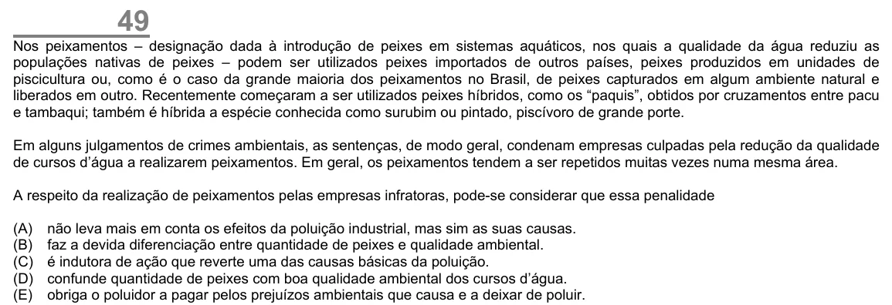

Texto extraído (pode conter ruído)

49  
Nos peixamentos – designação dada à introdução de peixes em sistemas aquáticos, nos quais a qualidade da água reduziu as  
populações nativas de peixes – podem ser utilizados peixes importados de outros países, peixes produzidos em unidades de  
piscicultura ou, como é o caso da grande maioria dos peixamentos no Brasil, de peixes capturados em algum ambiente natural e  
liberados em outro. Recentemente começaram a ser utilizados peixes híbridos, como os “paquis”, obtidos por cruzamentos entre pacu  
e tambaqui; também é híbrida a espécie conhecida como surubim ou pintado, piscívoro de grande porte.  
Em alguns julgamentos de crimes ambientais, as sentenças, de modo geral, condenam empresas culpadas pela redução da qualidade  
de cursos d’água a realizarem peixamentos. Em geral, os peixamentos tendem a ser repetidos muitas vezes numa mesma área.  
A respeito da realização de peixamentos pelas empresas infratoras, pode-se considerar que essa penalidade  
(A)  
não leva mais em conta os efeitos da poluição industrial, mas sim as suas causas.  
(B)  
faz a devida diferenciação entre quantidade de peixes e qualidade ambiental.  
(C)  
é indutora de ação que reverte uma das causas básicas da poluição.  
(D)  
confunde quantidade de peixes com boa qualidade ambiental dos cursos d’água.  
(E)  
obriga o poluidor a pagar pelos prejuízos ambientais que causa e a deixar de poluir.

