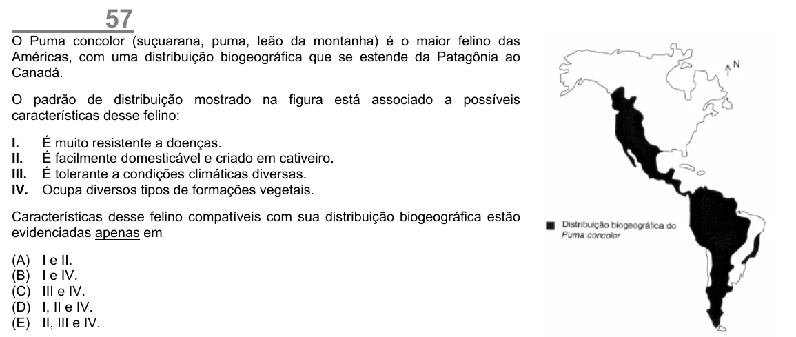

Texto extraído (pode conter ruído)

57  
O Puma concolor (suçuarana, puma, leão da montanha) é o maior felino das  
Américas, com uma distribuição biogeográfica que se estende da Patagônia ao  
Canadá.  
O padrão de distribuição mostrado na figura está associado a possíveis  
características desse felino:  
I.  
É muito resistente a doenças.  
II.  
É facilmente domesticável e criado em cativeiro.  
III.  
É tolerante a condições climáticas diversas.  
IV.  
Ocupa diversos tipos de formações vegetais.  
Características desse felino compatíveis com sua distribuição biogeográfica estão  
evidenciadas apenas em  
(A)  
I e II.  
(B)  
I e IV.  
(C)  
III e IV.  
(D)  
I, II e IV.  
(E)  
II, III e IV.

