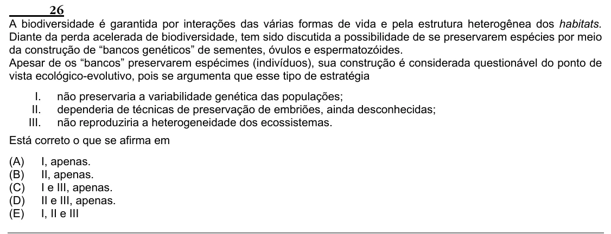

Texto extraído (pode conter ruído)

26  
A biodiversidade é garantida por interações das várias formas de vida e pela estrutura heterogênea dos habitats.  
Diante da perda acelerada de biodiversidade, tem sido discutida a possibilidade de se preservarem espécies por meio  
da construção de “bancos genéticos” de sementes, óvulos e espermatozóides.  
Apesar de os “bancos” preservarem espécimes (indivíduos), sua construção é considerada questionável do ponto de  
vista ecológico-evolutivo, pois se argumenta que esse tipo de estratégia  
I.  
não preservaria a variabilidade genética das populações;  
II.  
dependeria de técnicas de preservação de embriões, ainda desconhecidas;  
III.  
não reproduziria a heterogeneidade dos ecossistemas.  
Está correto o que se afirma em  
(A)  
I, apenas.  
(B)  
II, apenas.  
(C)  
I e III, apenas.  
(D)  
II e III, apenas.  
(E)  
I, II e III

