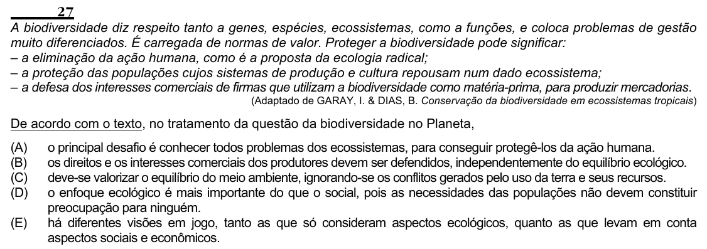

Texto extraído (pode conter ruído)

27  
A biodiversidade diz respeito tanto a genes, espécies, ecossistemas, como a funções, e coloca problemas de gestão  
muito diferenciados. É carregada de normas de valor. Proteger a biodiversidade pode significar:  
– a eliminação da ação humana, como é a proposta da ecologia radical;  
– a proteção das populações cujos sistemas de produção e cultura repousam num dado ecossistema;  
– a defesa dos interesses comerciais de firmas que utilizam a biodiversidade como matéria-prima, para produzir mercadorias.  
(Adaptado de GARAY, I. & DIAS, B. Conservação da biodiversidade em ecossistemas tropicais)  
De acordo com o texto, no tratamento da questão da biodiversidade no Planeta,  
(A)  
o principal desafio é conhecer todos problemas dos ecossistemas, para conseguir protegê-los da ação humana.  
(B)  
os direitos e os interesses comerciais dos produtores devem ser defendidos, independentemente do equilíbrio ecológico.  
(C)  
deve-se valorizar o equilíbrio do meio ambiente, ignorando-se os conflitos gerados pelo uso da terra e seus recursos.  
(D)  
o enfoque ecológico é mais importante do que o social, pois as necessidades das populações não devem constituir  
preocupação para ninguém.  
(E)  
há diferentes visões em jogo, tanto as que só consideram aspectos ecológicos, quanto as que levam em conta  
aspectos sociais e econômicos.

