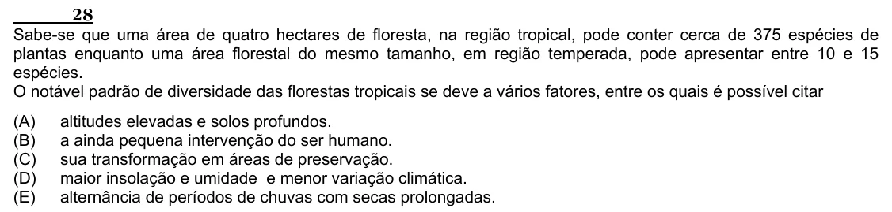

Texto extraído (pode conter ruído)

28  
Sabe-se que uma área de quatro hectares de floresta, na região tropical, pode conter cerca de 375 espécies de  
plantas enquanto uma área florestal do mesmo tamanho, em região temperada, pode apresentar entre 10 e 15  
espécies.  
O notável padrão de diversidade das florestas tropicais se deve a vários fatores, entre os quais é possível citar  
(A)  
altitudes elevadas e solos profundos.  
(B)  
a ainda pequena intervenção do ser humano.  
(C)  
sua transformação em áreas de preservação.  
(D)  
maior insolação e umidade e menor variação climática.  
(E)  
alternância de períodos de chuvas com secas prolongadas.

