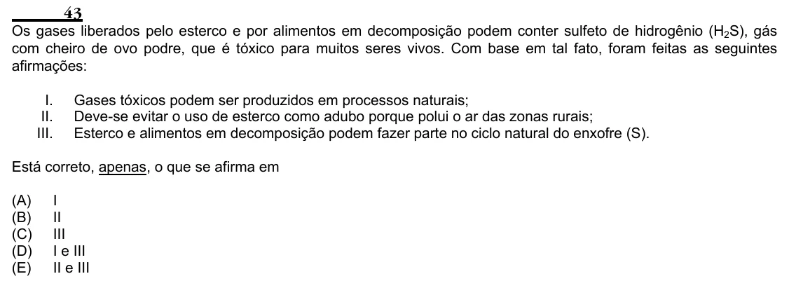

Texto extraído (pode conter ruído)

43  
Os gases liberados pelo esterco e por alimentos em decomposição podem conter sulfeto de hidrogênio (H 2 S), gás  
com cheiro de ovo podre, que é tóxico para muitos seres vivos. Com base em tal fato, foram feitas as seguintes  
afirmações:  
I.  
Gases tóxicos podem ser produzidos em processos naturais;  
II.  
Deve-se evitar o uso de esterco como adubo porque polui o ar das zonas rurais;  
III.  
Esterco e alimentos em decomposição podem fazer parte no ciclo natural do enxofre (S).  
Está correto, apenas, o que se afirma em  
(A)  
I  
(B)  
II  
(C)  
III  
(D)  
I e III  
(E)  
II e III

