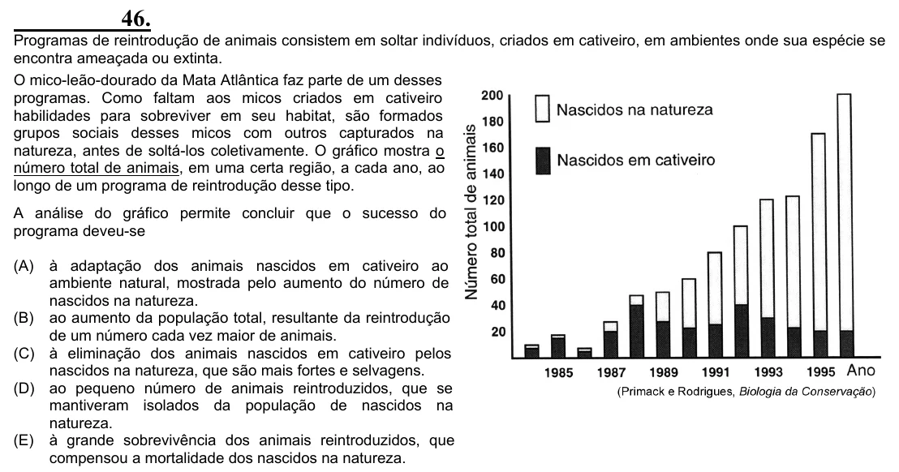

Texto extraído (pode conter ruído)

46.  
Programas de reintrodução de animais consistem em soltar indivíduos, criados em cativeiro, em ambientes onde sua espécie se  
encontra ameaçada ou extinta.  
O mico-leão-dourado da Mata Atlântica faz parte de um desses  
programas. Como faltam aos micos criados em cativeiro  
habilidades para sobreviver em seu habitat, são formados  
grupos sociais desses micos com outros capturados na  
natureza, antes de soltá-los coletivamente. O gráfico mostra o  
número total de animais, em uma certa região, a cada ano, ao  
longo de um programa de reintrodução desse tipo.  
A análise do gráfico permite concluir que o sucesso do  
programa deveu-se  
(A)  
à adaptação dos animais nascidos em cativeiro ao  
ambiente natural, mostrada pelo aumento do número de  
nascidos na natureza.  
(B) ao aumento da população total, resultante da reintrodução  
de um número cada vez maior de animais.  
(C) à eliminação dos animais nascidos em cativeiro pelos  
nascidos na natureza, que são mais fortes e selvagens.  
(D) ao pequeno número de animais reintroduzidos, que se  
mantiveram isolados da população de nascidos na  
natureza.  
(E) à grande sobrevivência dos animais reintroduzidos, que  
compensou a mortalidade dos nascidos na natureza.

