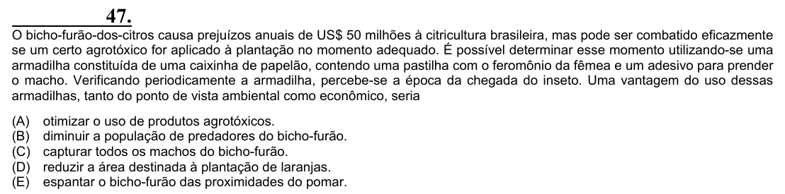

Texto extraído (pode conter ruído)

47.  
O bicho-furão-dos-citros causa prejuízos anuais de US$ 50 milhões à citricultura brasileira, mas pode ser combatido eficazmente  
se um certo agrotóxico for aplicado à plantação no momento adequado. É possível determinar esse momento utilizando-se uma  
armadilha constituída de uma caixinha de papelão, contendo uma pastilha com o feromônio da fêmea e um adesivo para prender  
o macho. Verificando periodicamente a armadilha, percebe-se a época da chegada do inseto. Uma vantagem do uso dessas  
armadilhas, tanto do ponto de vista ambiental como econômico, seria  
(A)  
otimizar o uso de produtos agrotóxicos.  
(B)  
diminuir a população de predadores do bicho-furão.  
(C)  
capturar todos os machos do bicho-furão.  
(D)  
reduzir a área destinada à plantação de laranjas.  
(E)  
espantar o bicho-furão das proximidades do pomar.

