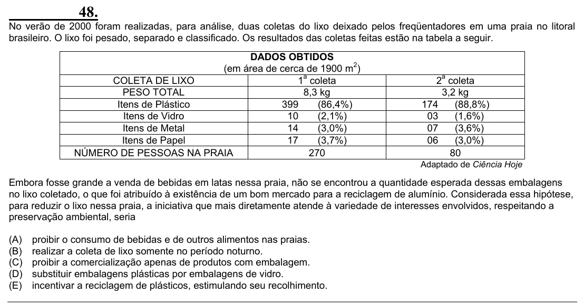

Texto extraído (pode conter ruído)

48.  
No verão de 2000 foram realizadas, para análise, duas coletas do lixo deixado pelos freqüentadores em uma praia no litoral  
brasileiro. O lixo foi pesado, separado e classificado. Os resultados das coletas feitas estão na tabela a seguir.  
DADOS OBTIDOS  
(em área de cerca de 1900 m 2 )  
1 a coleta  
2 a coleta  
COLETA DE LIXO  
PESO TOTAL  
8,3 kg  
3,2 kg  
Itens de Plástico  
399  
(86,4%)  
174  
(88,8%)  
Itens de Vidro  
10  
(2,1%)  
03  
(1,6%)  
Itens de Metal  
14  
(3,0%)  
07  
(3,6%)  
Itens de Papel  
17  
(3,7%)  
06  
(3,0%)  
NÚMERO DE PESSOAS NA PRAIA  
270  
80  
Adaptado de Ciência Hoje  
Embora fosse grande a venda de bebidas em latas nessa praia, não se encontrou a quantidade esperada dessas embalagens  
no lixo coletado, o que foi atribuído à existência de um bom mercado para a reciclagem de alumínio. Considerada essa hipótese,  
para reduzir o lixo nessa praia, a iniciativa que mais diretamente atende à variedade de interesses envolvidos, respeitando a  
preservação ambiental, seria  
(A)  
proibir o consumo de bebidas e de outros alimentos nas praias.  
(B)  
realizar a coleta de lixo somente no período noturno.  
(C)  
proibir a comercialização apenas de produtos com embalagem.  
(D)  
substituir embalagens plásticas por embalagens de vidro.  
(E)  
incentivar a reciclagem de plásticos, estimulando seu recolhimento.

