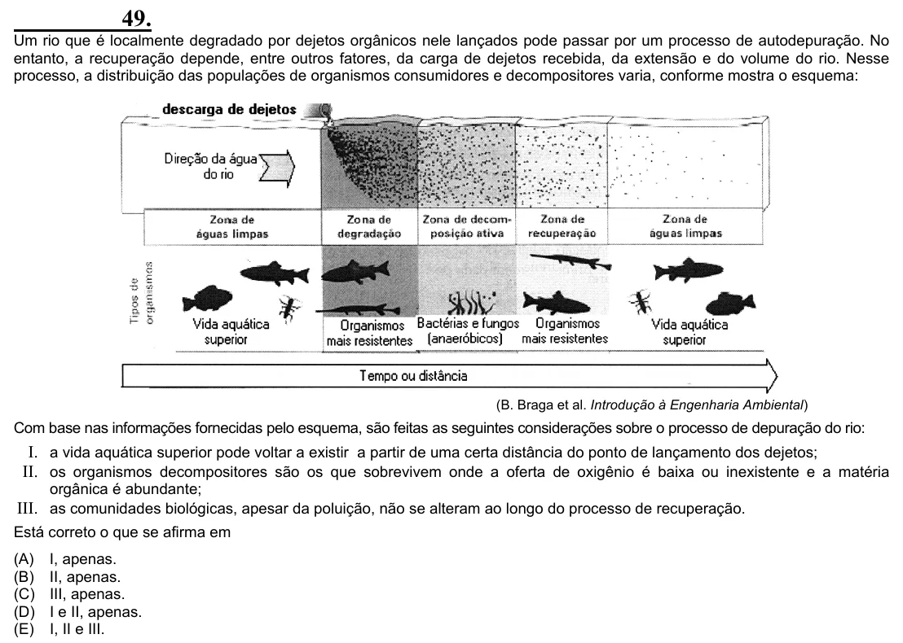

Texto extraído (pode conter ruído)

49.  
Um rio que é localmente degradado por dejetos orgânicos nele lançados pode passar por um processo de autodepuração. No  
entanto, a recuperação depende, entre outros fatores, da carga de dejetos recebida, da extensão e do volume do rio. Nesse  
processo, a distribuição das populações de organismos consumidores e decompositores varia, conforme mostra o esquema:  
(B. Braga et al. Introdução à Engenharia Ambiental)  
Com base nas informações fornecidas pelo esquema, são feitas as seguintes considerações sobre o processo de depuração do rio:  
I. a vida aquática superior pode voltar a existir a partir de uma certa distância do ponto de lançamento dos dejetos;  
II. os organismos decompositores são os que sobrevivem onde a oferta de oxigênio é baixa ou inexistente e a matéria  
orgânica é abundante;  
III. as comunidades biológicas, apesar da poluição, não se alteram ao longo do processo de recuperação.  
Está correto o que se afirma em  
(A)  
I, apenas.  
(B)  
II, apenas.  
(C)  
III, apenas.  
(D)  
I e II, apenas.  
(E)  
I, II e III.

