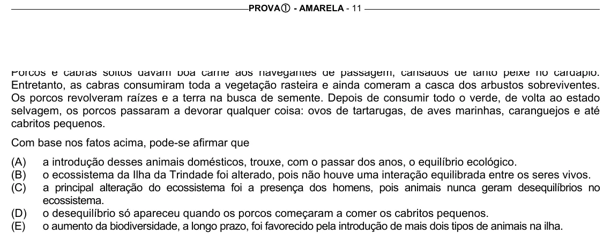

Texto extraído (pode conter ruído)

PROVA c - AMARELA - 11  
Entretanto, as cabras consumiram toda a vegetação rasteira e ainda comeram a casca dos arbustos sobreviventes.  
Os porcos revolveram raízes e a terra na busca de semente. Depois de consumir todo o verde, de volta ao estado  
selvagem, os porcos passaram a devorar qualquer coisa: ovos de tartarugas, de aves marinhas, caranguejos e até  
cabritos pequenos.  
Com base nos fatos acima, pode-se afirmar que  
(A)  
a introdução desses animais domésticos, trouxe, com o passar dos anos, o equilíbrio ecológico.  
(B)  
o ecossistema da Ilha da Trindade foi alterado, pois não houve uma interação equilibrada entre os seres vivos.  
(C)  
a principal alteração do ecossistema foi a presença dos homens, pois animais nunca geram desequilíbrios no  
ecossistema.  
(D)  
o desequilíbrio só apareceu quando os porcos começaram a comer os cabritos pequenos.  
(E)  
o aumento da biodiversidade, a longo prazo, foi favorecido pela introdução de mais dois tipos de animais na ilha.

