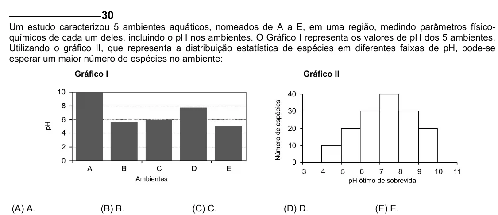

Texto extraído (pode conter ruído)

30  
Um estudo caracterizou 5 ambientes aquáticos, nomeados de A a E, em uma região, medindo parâmetros físico-  
químicos de cada um deles, incluindo o pH nos ambientes. O Gráfico I representa os valores de pH dos 5 ambientes.  
Utilizando o gráfico II, que representa a distribuição estatística de espécies em diferentes faixas de pH, pode-se  
esperar um maior número de espécies no ambiente:  
Gráfico I  
Gráfico II  
(A) A.  
(B) B.  
(C) C.  
(D) D.  
(E) E.

