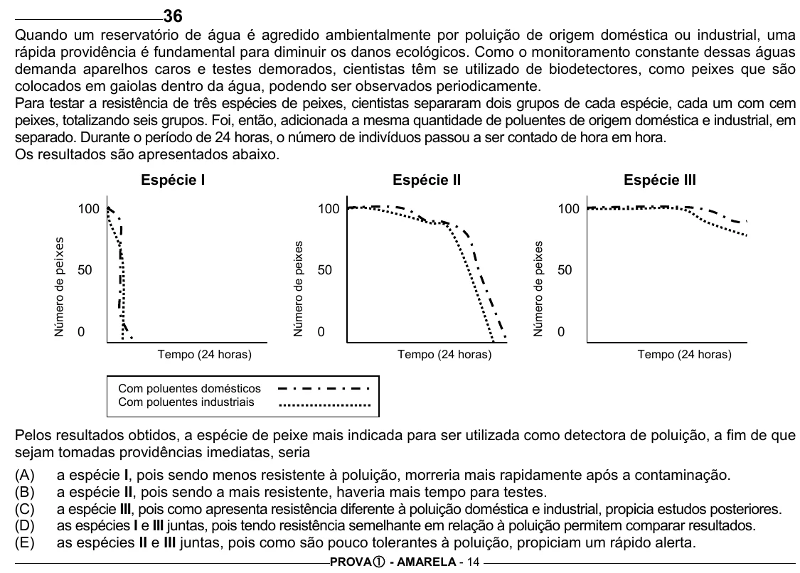

Texto extraído (pode conter ruído)

36  
Quando um reservatório de água é agredido ambientalmente por poluição de origem doméstica ou industrial, uma  
rápida providência é fundamental para diminuir os danos ecológicos. Como o monitoramento constante dessas águas  
demanda aparelhos caros e testes demorados, cientistas têm se utilizado de biodetectores, como peixes que são  
colocados em gaiolas dentro da água, podendo ser observados periodicamente.  
Para testar a resistência de três espécies de peixes, cientistas separaram dois grupos de cada espécie, cada um com cem  
peixes, totalizando seis grupos. Foi, então, adicionada a mesma quantidade de poluentes de origem doméstica e industrial, em  
separado. Durante o período de 24 horas, o número de indivíduos passou a ser contado de hora em hora.  
Os resultados são apresentados abaixo.  
Espécie I  
Espécie II  
Espécie III  
100  
100  
100  
Número de peixes  
Número de peixes  
Número de peixes  
50  
50  
50  
0  
0  
0  
Tempo (24 horas)  
Tempo (24 horas)  
Tempo (24 horas)  
Com poluentes domésticos  
Com poluentes industriais  
Pelos resultados obtidos, a espécie de peixe mais indicada para ser utilizada como detectora de poluição, a fim de que  
sejam tomadas providências imediatas, seria  
(A)  
a espécie I, pois sendo menos resistente à poluição, morreria mais rapidamente após a contaminação.  
(B)  
a espécie II, pois sendo a mais resistente, haveria mais tempo para testes.  
(C)  
a espécie III, pois como apresenta resistência diferente à poluição doméstica e industrial, propicia estudos posteriores.  
(D)  
as espécies I e III juntas, pois tendo resistência semelhante em relação à poluição permitem comparar resultados.  
(E)  
as espécies II e III juntas, pois como são pouco tolerantes à poluição, propiciam um rápido alerta.  
PROVA c - AMARELA - 14

