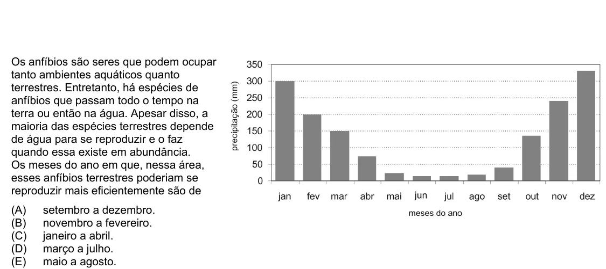

Texto extraído (pode conter ruído)

Os anfíbios são seres que podem ocupar  
tanto ambientes aquáticos quanto  
terrestres. Entretanto, há espécies de  
anfíbios que passam todo o tempo na  
terra ou então na água. Apesar disso, a  
maioria das espécies terrestres depende  
de água para se reproduzir e o faz  
quando essa existe em abundância.  
Os meses do ano em que, nessa área,  
esses anfíbios terrestres poderiam se  
reproduzir mais eficientemente são de  
(A)  
setembro a dezembro.  
(B)  
novembro a fevereiro.  
(C)  
janeiro a abril.  
(D)  
março a julho.  
(E)  
maio a agosto.

