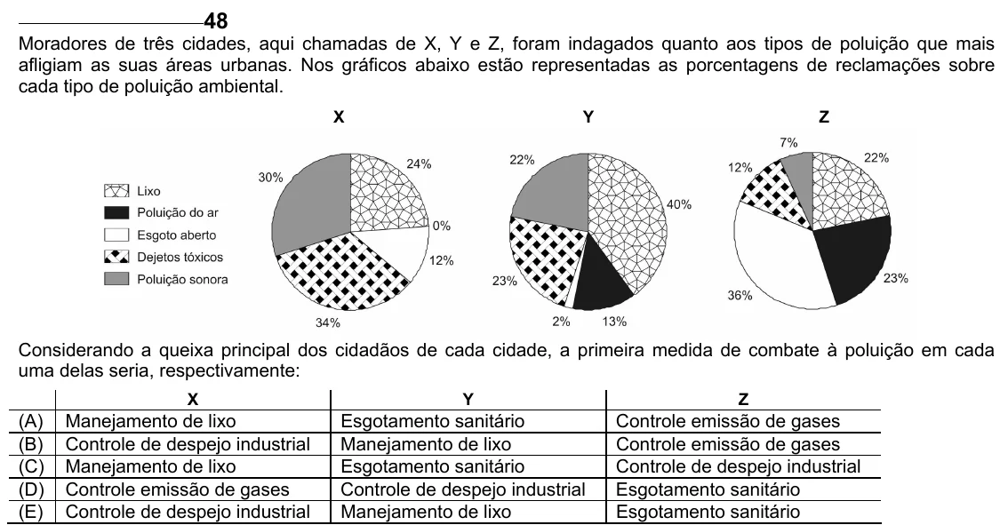

Texto extraído (pode conter ruído)

48  
Moradores de três cidades, aqui chamadas de X, Y e Z, foram indagados quanto aos tipos de poluição que mais  
afligiam as suas áreas urbanas. Nos gráficos abaixo estão representadas as porcentagens de reclamações sobre  
cada tipo de poluição ambiental.  
X  
Y  
Z  
Considerando a queixa principal dos cidadãos de cada cidade, a primeira medida de combate à poluição em cada  
uma delas seria, respectivamente:  
X  
Y  
Z  
(A)  
Manejamento de lixo  
Esgotamento sanitário  
Controle emissão de gases  
(B)  
Controle de despejo industrial  
Manejamento de lixo  
Controle emissão de gases  
(C)  
Manejamento de lixo  
Esgotamento sanitário  
Controle de despejo industrial  
(D)  
Controle emissão de gases  
Controle de despejo industrial  
Esgotamento sanitário  
(E)  
Controle de despejo industrial  
Manejamento de lixo  
Esgotamento sanitário

