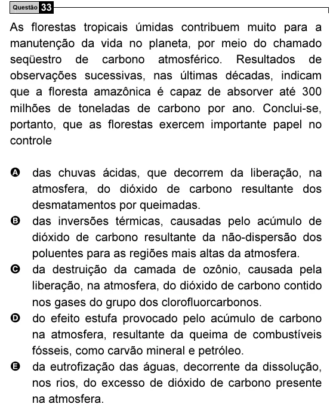

Texto extraído (pode conter ruído)

Questão 33  
As florestas tropicais úmidas contribuem muito para a  
manutenção da vida no planeta, por meio do chamado  
seqüestro de carbono atmosférico. Resultados de  
observações sucessivas, nas últimas décadas, indicam  
que a floresta amazônica é capaz de absorver até 300  
milhões de toneladas de carbono por ano. Conclui-se,  
portanto, que as florestas exercem importante papel no  
controle  
A das chuvas ácidas, que decorrem da liberação, na  
atmosfera, do dióxido de carbono resultante dos  
desmatamentos por queimadas.  
B das inversões térmicas, causadas pelo acúmulo de  
dióxido de carbono resultante da não-dispersão dos  
poluentes para as regiões mais altas da atmosfera.  
C da destruição da camada de ozônio, causada pela  
liberação, na atmosfera, do dióxido de carbono contido  
nos gases do grupo dos clorofluorcarbonos.  
D do efeito estufa provocado pelo acúmulo de carbono  
na atmosfera, resultante da queima de combustíveis  
fósseis, como carvão mineral e petróleo.  
E da eutrofização das águas, decorrente da dissolução,  
nos rios, do excesso de dióxido de carbono presente  
na atmosfera.

