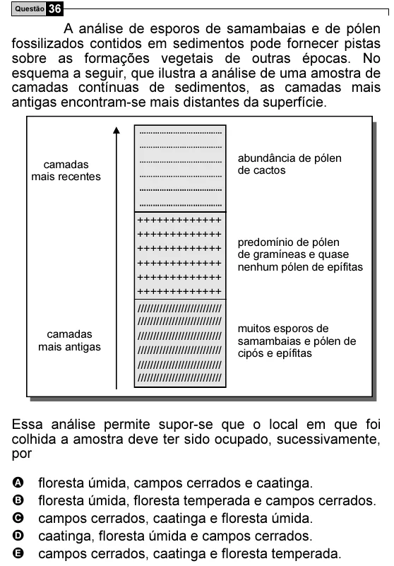

Texto extraído (pode conter ruído)

Questão 36  
A análise de esporos de samambaias e de pólen  
fossilizados contidos em sedimentos pode fornecer pistas  
sobre as formações vegetais de outras épocas. No  
esquema a seguir, que ilustra a análise de uma amostra de  
camadas contínuas de sedimentos, as camadas mais  
antigas encontram-se mais distantes da superfície.  
abundância de pólen  
camadas  
de cactos  
mais recentes  
+++++++++++++  
+++++++++++++  
predomínio de pólen  
+++++++++++++  
de gramíneas e quase  
+++++++++++++  
nenhum pólen de epífitas  
+++++++++++++  
+++++++++++++  
///////////////////////////  
///////////////////////////  
muitos esporos de  
camadas  
///////////////////////////  
samambaias e pólen de  
mais antigas  
///////////////////////////  
cipós e epífitas  
///////////////////////////  
///////////////////////////  
Essa análise permite supor-se que o local em que foi  
colhida a amostra deve ter sido ocupado, sucessivamente,  
por  
A  
floresta úmida, campos cerrados e caatinga.  
B  
floresta úmida, floresta temperada e campos cerrados.  
C  
campos cerrados, caatinga e floresta úmida.  
D  
caatinga, floresta úmida e campos cerrados.  
E  
campos cerrados, caatinga e floresta temperada.

