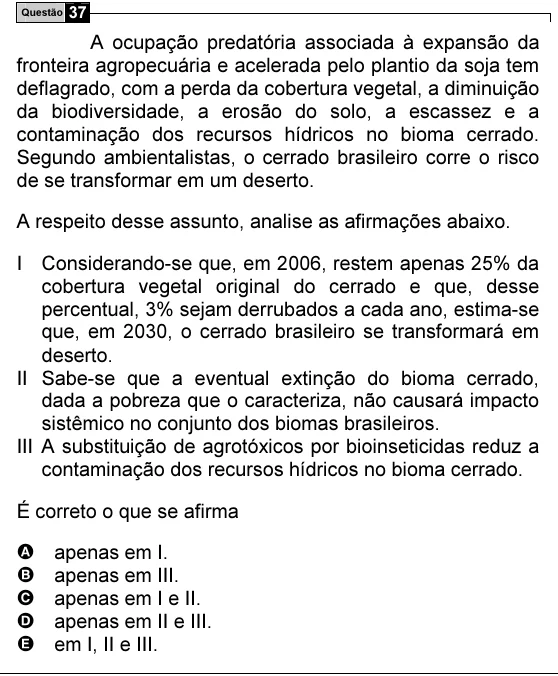

Texto extraído (pode conter ruído)

Questão 37  
A ocupação predatória associada à expansão da  
fronteira agropecuária e acelerada pelo plantio da soja tem  
deflagrado, com a perda da cobertura vegetal, a diminuição  
da biodiversidade, a erosão do solo, a escassez e a  
contaminação dos recursos hídricos no bioma cerrado.  
Segundo ambientalistas, o cerrado brasileiro corre o risco  
de se transformar em um deserto.  
A respeito desse assunto, analise as afirmações abaixo.  
I Considerando-se que, em 2006, restem apenas 25% da  
cobertura vegetal original do cerrado e que, desse  
percentual, 3% sejam derrubados a cada ano, estima-se  
que, em 2030, o cerrado brasileiro se transformará em  
deserto.  
II Sabe-se que a eventual extinção do bioma cerrado,  
dada a pobreza que o caracteriza, não causará impacto  
sistêmico no conjunto dos biomas brasileiros.  
III A substituição de agrotóxicos por bioinseticidas reduz a  
contaminação dos recursos hídricos no bioma cerrado.  
É correto o que se afirma  
A  
apenas em I.  
B  
apenas em III.  
C  
apenas em I e II.  
D  
apenas em II e III.  
E  
em I, II e III.

