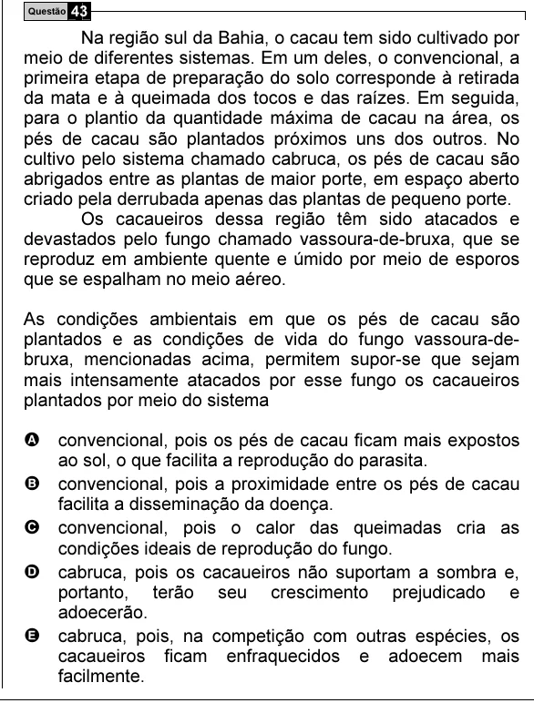

Texto extraído (pode conter ruído)

Questão 43  
Na região sul da Bahia, o cacau tem sido cultivado por  
meio de diferentes sistemas. Em um deles, o convencional, a  
primeira etapa de preparação do solo corresponde à retirada  
da mata e à queimada dos tocos e das raízes. Em seguida,  
para o plantio da quantidade máxima de cacau na área, os  
pés de cacau são plantados próximos uns dos outros. No  
cultivo pelo sistema chamado cabruca, os pés de cacau são  
abrigados entre as plantas de maior porte, em espaço aberto  
criado pela derrubada apenas das plantas de pequeno porte.  
Os cacaueiros dessa região têm sido atacados e  
devastados pelo fungo chamado vassoura-de-bruxa, que se  
reproduz em ambiente quente e úmido por meio de esporos  
que se espalham no meio aéreo.  
As condições ambientais em que os pés de cacau são  
plantados e as condições de vida do fungo vassoura-de-  
bruxa, mencionadas acima, permitem supor-se que sejam  
mais intensamente atacados por esse fungo os cacaueiros  
plantados por meio do sistema  
A convencional, pois os pés de cacau ficam mais expostos  
ao sol, o que facilita a reprodução do parasita.  
B convencional, pois a proximidade entre os pés de cacau  
facilita a disseminação da doença.  
C convencional, pois o calor das queimadas cria as  
condições ideais de reprodução do fungo.  
D cabruca, pois os cacaueiros não suportam a sombra e,  
portanto, terão seu crescimento prejudicado e  
adoecerão.  
E cabruca, pois, na competição com outras espécies, os  
cacaueiros ficam enfraquecidos e adoecem mais  
facilmente.

