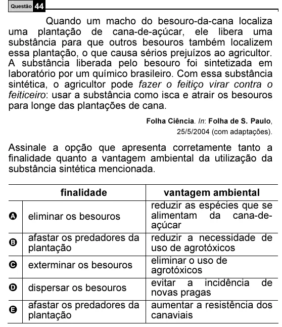

Texto extraído (pode conter ruído)

Questão 44  
Quando um macho do besouro-da-cana localiza  
uma plantação de cana-de-açúcar, ele libera uma  
substância para que outros besouros também localizem  
essa plantação, o que causa sérios prejuízos ao agricultor.  
A substância liberada pelo besouro foi sintetizada em  
laboratório por um químico brasileiro. Com essa substância  
sintética, o agricultor pode fazer o feitiço virar contra o  
feiticeiro: usar a substância como isca e atrair os besouros  
para longe das plantações de cana.  
Folha Ciência. In: Folha de S. Paulo,  
25/5/2004 (com adaptações).  
Assinale a opção que apresenta corretamente tanto a  
finalidade quanto a vantagem ambiental da utilização da  
substância sintética mencionada.  
finalidade  
vantagem ambiental  
reduzir as espécies que se  
A  
eliminar os besouros  
alimentam da cana-de-  
açúcar  
afastar os predadores da  
reduzir a necessidade de  
B  
plantação  
uso de agrotóxicos  
eliminar o uso de  
C  
exterminar os besouros  
agrotóxicos  
evitar a incidência de  
D  
dispersar os besouros  
novas pragas  
afastar os predadores da  
aumentar a resistência dos  
E  
plantação  
canaviais

