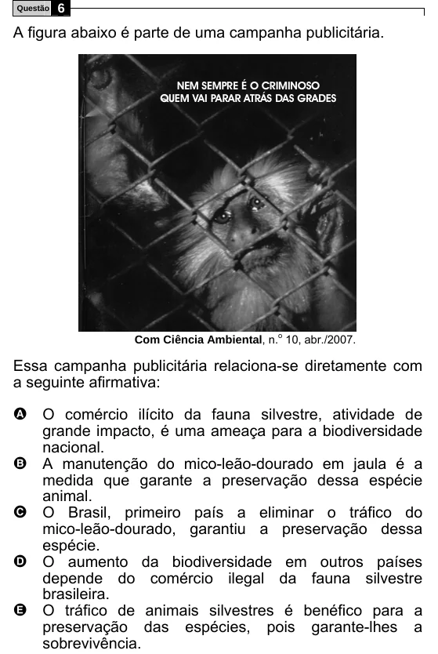

Texto extraído (pode conter ruído)

Questão  
6  
A figura abaixo é parte de uma campanha publicitária.  
NEM SEMPRE É O CRIMINOSO  
QUEM VAI PARAR ATRÁS DAS GRADES  
Com Ciência Ambiental, n. o 10, abr./2007.  
Essa campanha publicitária relaciona-se diretamente com  
a seguinte afirmativa:  
A O comércio ilícito da fauna silvestre, atividade de  
grande impacto, é uma ameaça para a biodiversidade  
nacional.  
B  
A manutenção do mico-leão-dourado em jaula é a  
medida que garante a preservação dessa espécie  
animal.  
C  
O Brasil, primeiro país a eliminar o tráfico do  
mico-leão-dourado, garantiu a preservação dessa  
espécie.  
D  
O aumento da biodiversidade em outros países  
depende do comércio ilegal da fauna silvestre  
brasileira.  
E  
O tráfico de animais silvestres é benéfico para a  
preservação das espécies, pois garante-lhes a  
sobrevivência.

