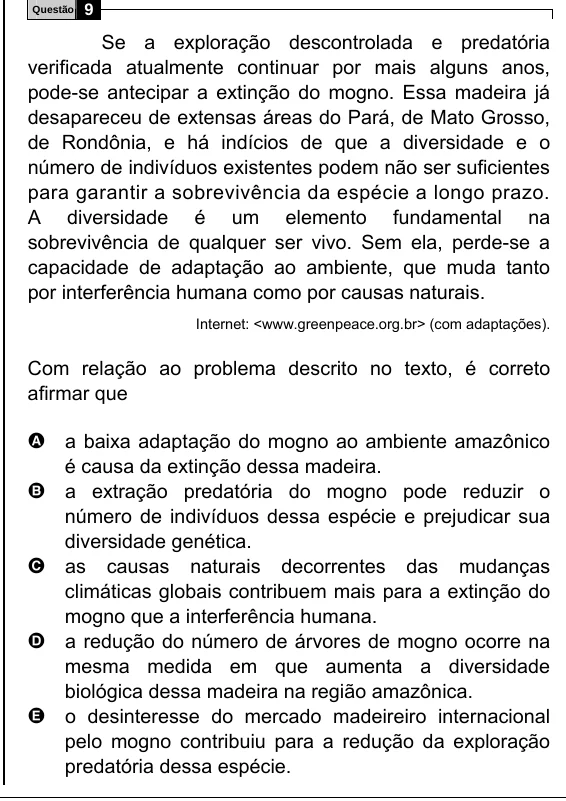

Texto extraído (pode conter ruído)

9  
Questão  
Se a exploração descontrolada e predatória  
verificada atualmente continuar por mais alguns anos,  
pode-se antecipar a extinção do mogno. Essa madeira já  
desapareceu de extensas áreas do Pará, de Mato Grosso,  
de Rondônia, e há indícios de que a diversidade e o  
número de indivíduos existentes podem não ser suficientes  
para garantir a sobrevivência da espécie a longo prazo.  
A diversidade é um elemento fundamental na  
sobrevivência de qualquer ser vivo. Sem ela, perde-se a  
capacidade de adaptação ao ambiente, que muda tanto  
por interferência humana como por causas naturais.  
Internet: <www.greenpeace.org.br> (com adaptações).  
Com relação ao problema descrito no texto, é correto  
afirmar que  
A a baixa adaptação do mogno ao ambiente amazônico  
é causa da extinção dessa madeira.  
B a extração predatória do mogno pode reduzir o  
número de indivíduos dessa espécie e prejudicar sua  
diversidade genética.  
C as causas naturais decorrentes das mudanças  
climáticas globais contribuem mais para a extinção do  
mogno que a interferência humana.  
D a redução do número de árvores de mogno ocorre na  
mesma medida em que aumenta a diversidade  
biológica dessa madeira na região amazônica.  
E o desinteresse do mercado madeireiro internacional  
pelo mogno contribuiu para a redução da exploração  
predatória dessa espécie.

