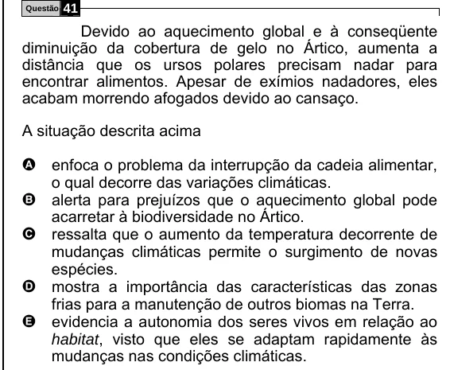

Texto extraído (pode conter ruído)

Questão  
41  
Devido ao aquecimento global e à conseqüente  
diminuição da cobertura de gelo no Ártico, aumenta a  
distância que os ursos polares precisam nadar para  
encontrar alimentos. Apesar de exímios nadadores, eles  
acabam morrendo afogados devido ao cansaço.  
A situação descrita acima  
A enfoca o problema da interrupção da cadeia alimentar,  
o qual decorre das variações climáticas.  
B alerta para prejuízos que o aquecimento global pode  
acarretar à biodiversidade no Ártico.  
C ressalta que o aumento da temperatura decorrente de  
mudanças climáticas permite o surgimento de novas  
espécies.  
D mostra a importância das características das zonas  
frias para a manutenção de outros biomas na Terra.  
E evidencia a autonomia dos seres vivos em relação ao  
habitat, visto que eles se adaptam rapidamente às  
mudanças nas condições climáticas.

