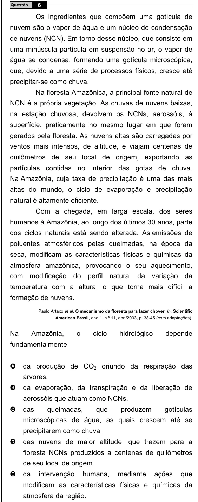

Texto extraído (pode conter ruído)

6  
Questão  
Os ingredientes que compõem uma gotícula de  
nuvem são o vapor de água e um núcleo de condensação  
de nuvens (NCN). Em torno desse núcleo, que consiste em  
uma minúscula partícula em suspensão no ar, o vapor de  
água se condensa, formando uma gotícula microscópica,  
que, devido a uma série de processos físicos, cresce até  
precipitar-se como chuva.  
Na floresta Amazônica, a principal fonte natural de  
NCN é a própria vegetação. As chuvas de nuvens baixas,  
na estação chuvosa, devolvem os NCNs, aerossóis, à  
superfície, praticamente no mesmo lugar em que foram  
gerados pela floresta. As nuvens altas são carregadas por  
ventos mais intensos, de altitude, e viajam centenas de  
quilômetros de seu local de origem, exportando as  
partículas contidas no interior das gotas de chuva.  
Na Amazônia, cuja taxa de precipitação é uma das mais  
altas do mundo, o ciclo de evaporação e precipitação  
natural é altamente eficiente.  
Com a chegada, em larga escala, dos seres  
humanos à Amazônia, ao longo dos últimos 30 anos, parte  
dos ciclos naturais está sendo alterada. As emissões de  
poluentes atmosféricos pelas queimadas, na época da  
seca, modificam as características físicas e químicas da  
atmosfera amazônica, provocando o seu aquecimento,  
com modificação do perfil natural da variação da  
temperatura com a altura, o que torna mais difícil a  
formação de nuvens.  
Paulo Artaxo et al. O mecanismo da floresta para fazer chover. In: Scientific  
American Brasil, ano 1, n.º 11, abr./2003, p. 38-45 (com adaptações).  
Na  
Amazônia,  
o  
ciclo  
hidrológico  
depende  
fundamentalmente  
A  
da produção de CO 2 oriundo da respiração das  
árvores.  
da evaporação, da transpiração e da liberação de  
B  
aerossóis que atuam como NCNs.  
das  
queimadas,  
que  
produzem  
gotículas  
C  
microscópicas de água, as quais crescem até se  
precipitarem como chuva.  
D  
das nuvens de maior altitude, que trazem para a  
floresta NCNs produzidos a centenas de quilômetros  
de seu local de origem.  
E  
da  
intervenção  
humana,  
mediante  
ações  
que  
modificam as características físicas e químicas da  
atmosfera da região.

