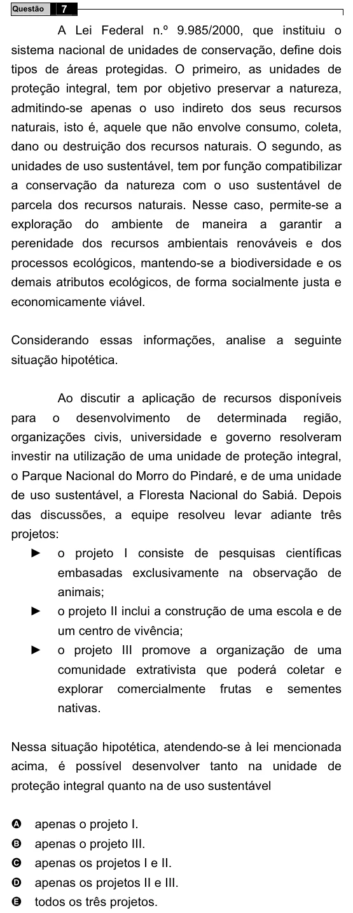

Texto extraído (pode conter ruído)

7  
Questão  
A Lei Federal n.º 9.985/2000, que instituiu o  
sistema nacional de unidades de conservação, define dois  
tipos de áreas protegidas. O primeiro, as unidades de  
proteção integral, tem por objetivo preservar a natureza,  
admitindo-se apenas o uso indireto dos seus recursos  
naturais, isto é, aquele que não envolve consumo, coleta,  
dano ou destruição dos recursos naturais. O segundo, as  
unidades de uso sustentável, tem por função compatibilizar  
a conservação da natureza com o uso sustentável de  
parcela dos recursos naturais. Nesse caso, permite-se a  
exploração  
do  
ambiente  
de  
maneira  
a  
garantir  
a  
perenidade dos recursos ambientais renováveis e dos  
processos ecológicos, mantendo-se a biodiversidade e os  
demais atributos ecológicos, de forma socialmente justa e  
economicamente viável.  
Considerando essas informações, analise a seguinte  
situação hipotética.  
Ao discutir a aplicação de recursos disponíveis  
para  
o  
desenvolvimento  
de  
determinada  
região,  
organizações civis, universidade e governo resolveram  
investir na utilização de uma unidade de proteção integral,  
o Parque Nacional do Morro do Pindaré, e de uma unidade  
de uso sustentável, a Floresta Nacional do Sabiá. Depois  
das discussões, a equipe resolveu levar adiante três  
projetos:  
Ź  
o projeto I consiste de pesquisas científicas  
embasadas exclusivamente na observação de  
animais;  
o projeto II inclui a construção de uma escola e de  
Ź  
um centro de vivência;  
o projeto III promove a organização de uma  
Ź  
comunidade extrativista que poderá coletar e  
explorar  
comercialmente  
frutas  
e  
sementes  
nativas.  
Nessa situação hipotética, atendendo-se à lei mencionada  
acima, é possível desenvolver tanto na unidade de  
proteção integral quanto na de uso sustentável  
A  
apenas o projeto I.  
B  
apenas o projeto III.  
apenas os projetos I e II.  
C  
apenas os projetos II e III.  
D  
todos os três projetos.  
E

