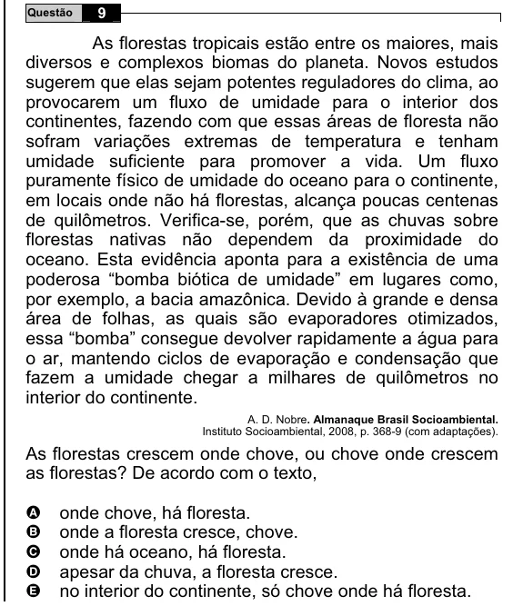

Texto extraído (pode conter ruído)

Questão  
9  
As florestas tropicais estão entre os maiores, mais  
diversos e complexos biomas do planeta. Novos estudos  
sugerem que elas sejam potentes reguladores do clima, ao  
provocarem um fluxo de umidade para o interior dos  
continentes, fazendo com que essas áreas de floresta não  
sofram variações extremas de temperatura e tenham  
umidade suficiente para promover a vida. Um fluxo  
puramente físico de umidade do oceano para o continente,  
em locais onde não há florestas, alcança poucas centenas  
de quilômetros. Verifica-se, porém, que as chuvas sobre  
florestas nativas não dependem da proximidade do  
oceano. Esta evidência aponta para a existência de uma  
poderosa “bomba biótica de umidade” em lugares como,  
por exemplo, a bacia amazônica. Devido à grande e densa  
área de folhas, as quais são evaporadores otimizados,  
essa “bomba” consegue devolver rapidamente a água para  
o ar, mantendo ciclos de evaporação e condensação que  
fazem a umidade chegar a milhares de quilômetros no  
interior do continente.  
A. D. Nobre. Almanaque Brasil Socioambiental.  
Instituto Socioambiental, 2008, p. 368-9 (com adaptações).  
As florestas crescem onde chove, ou chove onde crescem  
as florestas? De acordo com o texto,  
A  
onde chove, há floresta.  
onde a floresta cresce, chove.  
B  
onde há oceano, há floresta.  
C  
D  
apesar da chuva, a floresta cresce.  
no interior do continente, só chove onde há floresta.  
E

