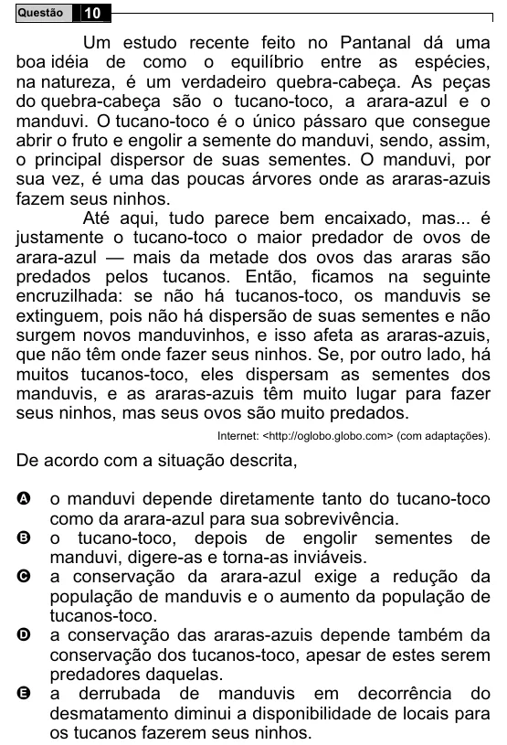

Texto extraído (pode conter ruído)

10  
Questão  
Um estudo recente feito no Pantanal dá uma  
boa idéia de como o equilíbrio entre as espécies,  
na natureza, é um verdadeiro quebra-cabeça. As peças  
do quebra-cabeça são o tucano-toco, a arara-azul e o  
manduvi. O tucano-toco é o único pássaro que consegue  
abrir o fruto e engolir a semente do manduvi, sendo, assim,  
o principal dispersor de suas sementes. O manduvi, por  
sua vez, é uma das poucas árvores onde as araras-azuis  
fazem seus ninhos.  
Até aqui, tudo parece bem encaixado, mas... é  
justamente o tucano-toco o maior predador de ovos de  
arara-azul — mais da metade dos ovos das araras são  
predados pelos tucanos. Então, ficamos na seguinte  
encruzilhada: se não há tucanos-toco, os manduvis se  
extinguem, pois não há dispersão de suas sementes e não  
surgem novos manduvinhos, e isso afeta as araras-azuis,  
que não têm onde fazer seus ninhos. Se, por outro lado, há  
muitos tucanos-toco, eles dispersam as sementes dos  
manduvis, e as araras-azuis têm muito lugar para fazer  
seus ninhos, mas seus ovos são muito predados.  
Internet: <http://oglobo.globo.com> (com adaptações).  
De acordo com a situação descrita,  
o manduvi depende diretamente tanto do tucano-toco  
A  
como da arara-azul para sua sobrevivência.  
B  
o tucano-toco, depois de engolir sementes de  
manduvi, digere-as e torna-as inviáveis.  
C  
a conservação da arara-azul exige a redução da  
população de manduvis e o aumento da população de  
tucanos-toco.  
D  
a conservação das araras-azuis depende também da  
conservação dos tucanos-toco, apesar de estes serem  
predadores daquelas.  
a derrubada de manduvis em decorrência do  
E  
desmatamento diminui a disponibilidade de locais para  
os tucanos fazerem seus ninhos.

