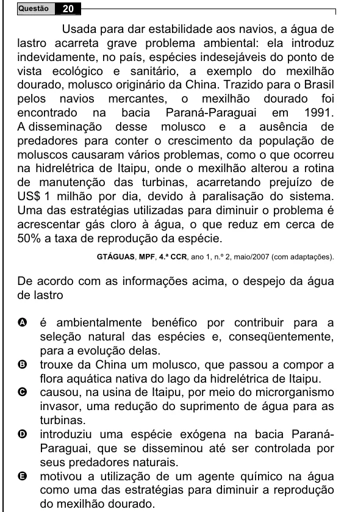

Texto extraído (pode conter ruído)

20  
Questão  
Usada para dar estabilidade aos navios, a água de  
lastro acarreta grave problema ambiental: ela introduz  
indevidamente, no país, espécies indesejáveis do ponto de  
vista ecológico e sanitário, a exemplo do mexilhão  
dourado, molusco originário da China. Trazido para o Brasil  
pelos navios mercantes, o mexilhão dourado foi  
encontrado na bacia Paraná-Paraguai em 1991.  
A disseminação desse molusco e a ausência de  
predadores para conter o crescimento da população de  
moluscos causaram vários problemas, como o que ocorreu  
na hidrelétrica de Itaipu, onde o mexilhão alterou a rotina  
de manutenção das turbinas, acarretando prejuízo de  
US$ 1 milhão por dia, devido à paralisação do sistema.  
Uma das estratégias utilizadas para diminuir o problema é  
acrescentar gás cloro à água, o que reduz em cerca de  
50% a taxa de reprodução da espécie.  
GTÁGUAS, MPF, 4.ª CCR, ano 1, n.º 2, maio/2007 (com adaptações).  
De acordo com as informações acima, o despejo da água  
de lastro  
é ambientalmente benéfico por contribuir para a  
A  
seleção natural das espécies e, conseqüentemente,  
para a evolução delas.  
trouxe da China um molusco, que passou a compor a  
B  
flora aquática nativa do lago da hidrelétrica de Itaipu.  
C  
causou, na usina de Itaipu, por meio do microrganismo  
invasor, uma redução do suprimento de água para as  
turbinas.  
D  
introduziu uma espécie exógena na bacia Paraná-  
Paraguai, que se disseminou até ser controlada por  
seus predadores naturais.  
E  
motivou a utilização de um agente químico na água  
como uma das estratégias para diminuir a reprodução  
do mexilhão dourado.

