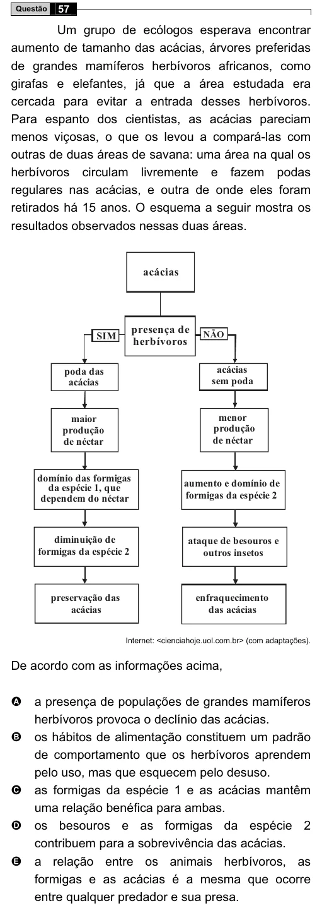

Texto extraído (pode conter ruído)

57  
Questão  
Um grupo de ecólogos esperava encontrar  
aumento de tamanho das acácias, árvores preferidas  
de grandes mamíferos herbívoros africanos, como  
girafas e elefantes, já que a área estudada era  
cercada para evitar a entrada desses herbívoros.  
Para espanto dos cientistas, as acácias pareciam  
menos viçosas, o que os levou a compará-las com  
outras de duas áreas de savana: uma área na qual os  
herbívoros circulam livremente e fazem podas  
regulares nas acácias, e outra de onde eles foram  
retirados há 15 anos. O esquema a seguir mostra os  
resultados observados nessas duas áreas.  
acácias  
presença de  
SIM  
NÃO  
herbívoros  
poda das  
acácias  
acácias  
sem poda  
maior  
menor  
produção  
produção  
de néctar  
de néctar  
domínio das formigas  
aumento e domínio de  
da espécie 1, que  
dependem do néctar  
formigas da espécie 2  
diminuição de  
ataque de besouros e  
formigas da espécie 2  
outros insetos  
preservação das  
enfraquecimento  
acácias  
das acácias  
Internet: <cienciahoje.uol.com.br> (com adaptações).  
De acordo com as informações acima,  
a presença de populações de grandes mamíferos  
A  
herbívoros provoca o declínio das acácias.  
os hábitos de alimentação constituem um padrão  
B  
de comportamento que os herbívoros aprendem  
pelo uso, mas que esquecem pelo desuso.  
C  
as formigas da espécie 1 e as acácias mantêm  
uma relação benéfica para ambas.  
D  
os besouros e as formigas da espécie 2  
contribuem para a sobrevivência das acácias.  
E  
a relação entre os animais herbívoros, as  
formigas e as acácias é a mesma que ocorre  
entre qualquer predador e sua presa.

