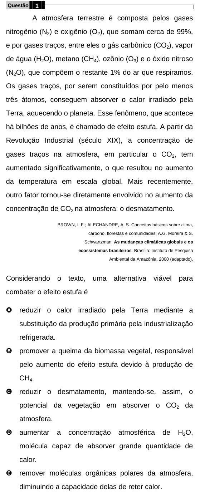

Texto extraído (pode conter ruído)

Questão  
1  
A atmosfera terrestre é composta pelos gases  
nitrogênio (N 2 ) e oxigênio (O 2 ), que somam cerca de 99%,  
e por gases traços, entre eles o gás carbônico (CO 2 ), vapor  
de água (H 2 O), metano (CH 4 ), ozônio (O 3 ) e o óxido nitroso  
(N 2 O), que compõem o restante 1% do ar que respiramos.  
Os gases traços, por serem constituídos por pelo menos  
três átomos, conseguem absorver o calor irradiado pela  
Terra, aquecendo o planeta. Esse fenômeno, que acontece  
há bilhões de anos, é chamado de efeito estufa. A partir da  
Revolução Industrial (século XIX), a concentração de  
gases traços na atmosfera, em particular o CO 2 , tem  
aumentado significativamente, o que resultou no aumento  
da temperatura em escala global. Mais recentemente,  
outro fator tornou-se diretamente envolvido no aumento da  
concentração de CO 2 na atmosfera: o desmatamento.  
BROWN, I. F.; ALECHANDRE, A. S. Conceitos básicos sobre clima,  
carbono, florestas e comunidades. A.G. Moreira & S.  
Schwartzman. As mudanças climáticas globais e os  
ecossistemas brasileiros. Brasília: Instituto de Pesquisa  
Ambiental da Amazônia, 2000 (adaptado).  
Considerando  
o  
texto,  
uma  
alternativa  
viável  
para  
combater o efeito estufa é  
A  
reduzir o calor irradiado pela Terra mediante a  
substituição da produção primária pela industrialização  
refrigerada.  
B  
promover a queima da biomassa vegetal, responsável  
pelo aumento do efeito estufa devido à produção de  
CH 4 .  
C  
reduzir o desmatamento, mantendo-se, assim, o  
potencial da vegetação em absorver o CO 2 da  
atmosfera.  
D  
aumentar  
a  
concentração  
atmosférica  
de  
H 2 O,  
molécula capaz de absorver grande quantidade de  
calor.  
E  
remover moléculas orgânicas polares da atmosfera,  
diminuindo a capacidade delas de reter calor.

