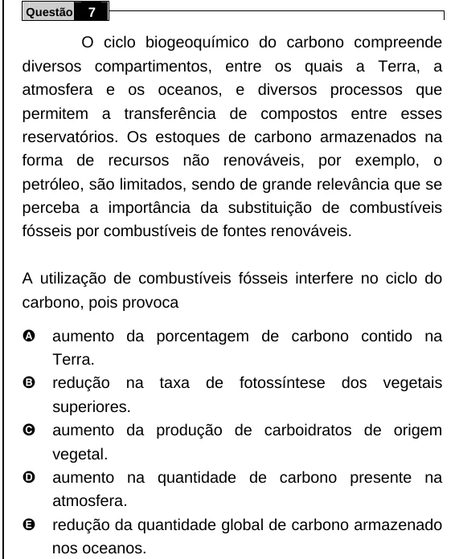

Texto extraído (pode conter ruído)

Questão  
7  
O ciclo biogeoquímico do carbono compreende  
diversos compartimentos, entre os quais a Terra, a  
atmosfera e os oceanos, e diversos processos que  
permitem a transferência de compostos entre esses  
reservatórios. Os estoques de carbono armazenados na  
forma de recursos não renováveis, por exemplo, o  
petróleo, são limitados, sendo de grande relevância que se  
perceba a importância da substituição de combustíveis  
fósseis por combustíveis de fontes renováveis.  
A utilização de combustíveis fósseis interfere no ciclo do  
carbono, pois provoca  
A  
aumento da porcentagem de carbono contido na  
Terra.  
B  
redução na taxa de fotossíntese dos vegetais  
superiores.  
C  
aumento da produção de carboidratos de origem  
vegetal.  
D  
aumento na quantidade de carbono presente na  
atmosfera.  
E  
redução da quantidade global de carbono armazenado  
nos oceanos.

