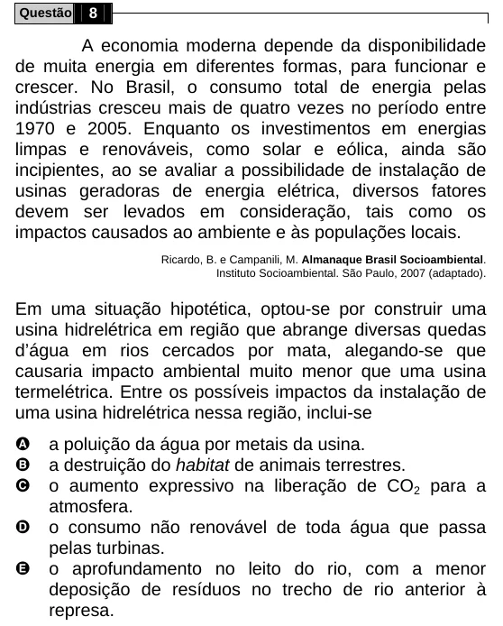

Texto extraído (pode conter ruído)

Questão  
8  
A economia moderna depende da disponibilidade  
de muita energia em diferentes formas, para funcionar e  
crescer. No Brasil, o consumo total de energia pelas  
indústrias cresceu mais de quatro vezes no período entre  
1970 e 2005. Enquanto os investimentos em energias  
limpas e renováveis, como solar e eólica, ainda são  
incipientes, ao se avaliar a possibilidade de instalação de  
usinas geradoras de energia elétrica, diversos fatores  
devem ser levados em consideração, tais como os  
impactos causados ao ambiente e às populações locais.  
Ricardo, B. e Campanili, M. Almanaque Brasil Socioambiental.  
Instituto Socioambiental. São Paulo, 2007 (adaptado).  
Em uma situação hipotética, optou-se por construir uma  
usina hidrelétrica em região que abrange diversas quedas  
d’água em rios cercados por mata, alegando-se que  
causaria impacto ambiental muito menor que uma usina  
termelétrica. Entre os possíveis impactos da instalação de  
uma usina hidrelétrica nessa região, inclui-se  
A  
a poluição da água por metais da usina.  
a destruição do habitat de animais terrestres.  
B  
C  
o aumento expressivo na liberação de CO 2 para a  
atmosfera.  
D  
o consumo não renovável de toda água que passa  
pelas turbinas.  
E  
o aprofundamento no leito do rio, com a menor  
deposição de resíduos no trecho de rio anterior à  
represa.

