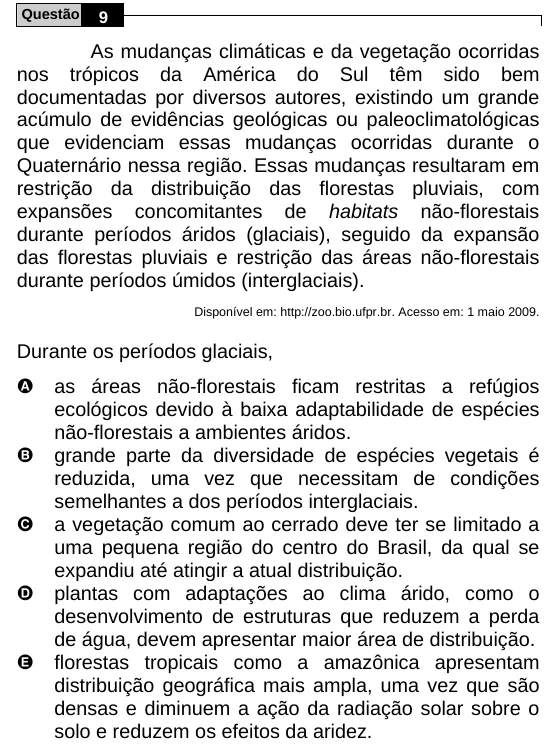

Texto extraído (pode conter ruído)

Questão  
9  
As mudanças climáticas e da vegetação ocorridas  
nos trópicos da América do Sul têm sido bem  
documentadas por diversos autores, existindo um grande  
acúmulo de evidências geológicas ou paleoclimatológicas  
que evidenciam essas mudanças ocorridas durante o  
Quaternário nessa região. Essas mudanças resultaram em  
restrição da distribuição das florestas pluviais, com  
expansões concomitantes de habitats não-florestais  
durante períodos áridos (glaciais), seguido da expansão  
das florestas pluviais e restrição das áreas não-florestais  
durante períodos úmidos (interglaciais).  
Disponível em: http://zoo.bio.ufpr.br. Acesso em: 1 maio 2009.  
Durante os períodos glaciais,  
A  
as áreas não-florestais ficam restritas a refúgios  
ecológicos devido à baixa adaptabilidade de espécies  
não-florestais a ambientes áridos.  
B  
grande parte da diversidade de espécies vegetais é  
reduzida, uma vez que necessitam de condições  
semelhantes a dos períodos interglaciais.  
C  
a vegetação comum ao cerrado deve ter se limitado a  
uma pequena região do centro do Brasil, da qual se  
expandiu até atingir a atual distribuição.  
D  
plantas com adaptações ao clima árido, como o  
desenvolvimento de estruturas que reduzem a perda  
de água, devem apresentar maior área de distribuição.  
E  
florestas tropicais como a amazônica apresentam  
distribuição geográfica mais ampla, uma vez que são  
densas e diminuem a ação da radiação solar sobre o  
solo e reduzem os efeitos da aridez.

