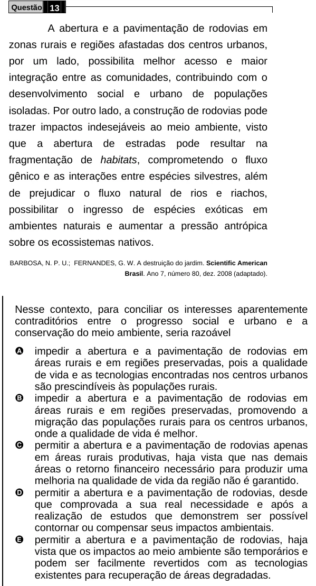

Texto extraído (pode conter ruído)

Questão 13  
A abertura e a pavimentação de rodovias em  
zonas rurais e regiões afastadas dos centros urbanos,  
por um lado, possibilita melhor acesso e maior  
integração entre as comunidades, contribuindo com o  
desenvolvimento social e urbano de populações  
isoladas. Por outro lado, a construção de rodovias pode  
trazer impactos indesejáveis ao meio ambiente, visto  
que  
a  
abertura  
de  
estradas  
pode  
resultar  
na  
fragmentação de habitats, comprometendo o fluxo  
gênico e as interações entre espécies silvestres, além  
de prejudicar o fluxo natural de rios e riachos,  
possibilitar o ingresso de espécies exóticas em  
ambientes naturais e aumentar a pressão antrópica  
sobre os ecossistemas nativos.  
BARBOSA, N. P. U.; FERNANDES, G. W. A destruição do jardim. Scientific American  
Brasil. Ano 7, número 80, dez. 2008 (adaptado).  
Nesse contexto, para conciliar os interesses aparentemente  
contraditórios entre o progresso social e urbano e a  
conservação do meio ambiente, seria razoável  
A  
impedir a abertura e a pavimentação de rodovias em  
áreas rurais e em regiões preservadas, pois a qualidade  
de vida e as tecnologias encontradas nos centros urbanos  
são prescindíveis às populações rurais.  
B  
impedir a abertura e a pavimentação de rodovias em  
áreas rurais e em regiões preservadas, promovendo a  
migração das populações rurais para os centros urbanos,  
onde a qualidade de vida é melhor.  
C  
permitir a abertura e a pavimentação de rodovias apenas  
em áreas rurais produtivas, haja vista que nas demais  
áreas o retorno financeiro necessário para produzir uma  
melhoria na qualidade de vida da região não é garantido.  
D  
permitir a abertura e a pavimentação de rodovias, desde  
que comprovada a sua real necessidade e após a  
realização de estudos que demonstrem ser possível  
contornar ou compensar seus impactos ambientais.  
E  
permitir a abertura e a pavimentação de rodovias, haja  
vista que os impactos ao meio ambiente são temporários e  
podem ser facilmente revertidos com as tecnologias  
existentes para recuperação de áreas degradadas.

