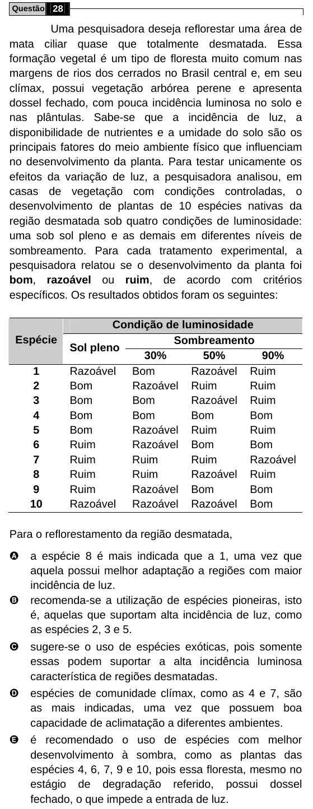

Texto extraído (pode conter ruído)

Questão 28  
Uma pesquisadora deseja reflorestar uma área de  
mata ciliar quase que totalmente desmatada. Essa  
formação vegetal é um tipo de floresta muito comum nas  
margens de rios dos cerrados no Brasil central e, em seu  
clímax, possui vegetação arbórea perene e apresenta  
dossel fechado, com pouca incidência luminosa no solo e  
nas plântulas. Sabe-se que a incidência de luz, a  
disponibilidade de nutrientes e a umidade do solo são os  
principais fatores do meio ambiente físico que influenciam  
no desenvolvimento da planta. Para testar unicamente os  
efeitos da variação de luz, a pesquisadora analisou, em  
casas de vegetação com condições controladas, o  
desenvolvimento de plantas de 10 espécies nativas da  
região desmatada sob quatro condições de luminosidade:  
uma sob sol pleno e as demais em diferentes níveis de  
sombreamento. Para cada tratamento experimental, a  
pesquisadora relatou se o desenvolvimento da planta foi  
bom, razoável ou ruim, de acordo com critérios  
específicos. Os resultados obtidos foram os seguintes:  
Condição de luminosidade  
Espécie  
Sombreamento  
Sol pleno  
30%  
50%  
90%  
1  
Razoável Bom  
Razoável Ruim  
2  
Bom  
Razoável Ruim  
Ruim  
3  
Bom  
Bom  
Razoável Ruim  
4  
Bom  
Bom  
Bom  
Bom  
5  
Bom  
Razoável Ruim  
Ruim  
6  
Ruim  
Razoável Bom  
Bom  
7  
Ruim  
Ruim  
Ruim  
Razoável  
8  
Ruim  
Ruim  
Razoável Ruim  
9  
Ruim  
Razoável Bom  
Bom  
10  
Razoável Razoável Razoável Bom  
Para o reflorestamento da região desmatada,  
A  
a espécie 8 é mais indicada que a 1, uma vez que  
aquela possui melhor adaptação a regiões com maior  
incidência de luz.  
B  
recomenda-se a utilização de espécies pioneiras, isto  
é, aquelas que suportam alta incidência de luz, como  
as espécies 2, 3 e 5.  
C  
sugere-se o uso de espécies exóticas, pois somente  
essas podem suportar a alta incidência luminosa  
característica de regiões desmatadas.  
D  
espécies de comunidade clímax, como as 4 e 7, são  
as mais indicadas, uma vez que possuem boa  
capacidade de aclimatação a diferentes ambientes.  
E  
é recomendado o uso de espécies com melhor  
desenvolvimento à sombra, como as plantas das  
espécies 4, 6, 7, 9 e 10, pois essa floresta, mesmo no  
estágio de degradação referido, possui dossel  
fechado, o que impede a entrada de luz.

