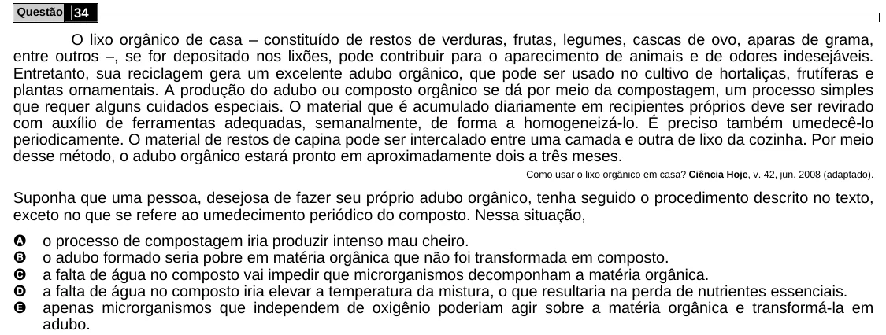

Texto extraído (pode conter ruído)

Questão 34  
O lixo orgânico de casa – constituído de restos de verduras, frutas, legumes, cascas de ovo, aparas de grama,  
entre outros –, se for depositado nos lixões, pode contribuir para o aparecimento de animais e de odores indesejáveis.  
Entretanto, sua reciclagem gera um excelente adubo orgânico, que pode ser usado no cultivo de hortaliças, frutíferas e  
plantas ornamentais. A produção do adubo ou composto orgânico se dá por meio da compostagem, um processo simples  
que requer alguns cuidados especiais. O material que é acumulado diariamente em recipientes próprios deve ser revirado  
com auxílio de ferramentas adequadas, semanalmente, de forma a homogeneizá-lo. É preciso também umedecê-lo  
periodicamente. O material de restos de capina pode ser intercalado entre uma camada e outra de lixo da cozinha. Por meio  
desse método, o adubo orgânico estará pronto em aproximadamente dois a três meses.  
Como usar o lixo orgânico em casa? Ciência Hoje, v. 42, jun. 2008 (adaptado).  
Suponha que uma pessoa, desejosa de fazer seu próprio adubo orgânico, tenha seguido o procedimento descrito no texto,  
exceto no que se refere ao umedecimento periódico do composto. Nessa situação,  
A  
o processo de compostagem iria produzir intenso mau cheiro.  
B  
o adubo formado seria pobre em matéria orgânica que não foi transformada em composto.  
C  
a falta de água no composto vai impedir que microrganismos decomponham a matéria orgânica.  
D  
a falta de água no composto iria elevar a temperatura da mistura, o que resultaria na perda de nutrientes essenciais.  
E  
apenas microrganismos que independem de oxigênio poderiam agir sobre a matéria orgânica e transformá-la em  
adubo.

