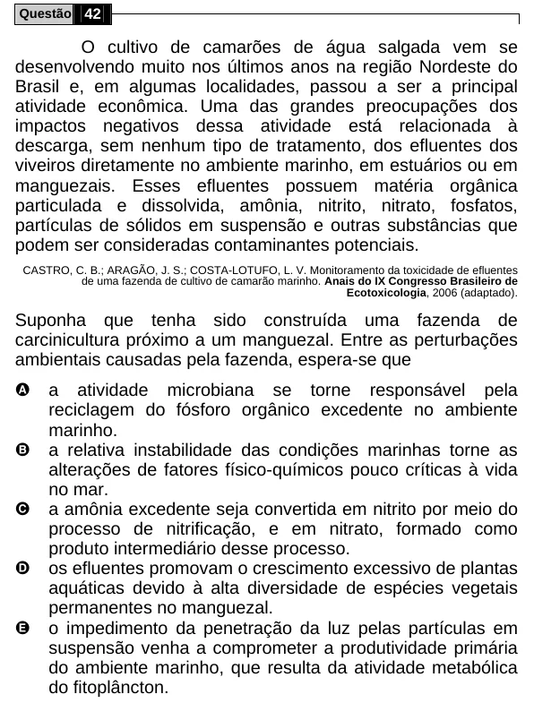

Texto extraído (pode conter ruído)

Questão 42  
O cultivo de camarões de água salgada vem se  
desenvolvendo muito nos últimos anos na região Nordeste do  
Brasil e, em algumas localidades, passou a ser a principal  
atividade econômica. Uma das grandes preocupações dos  
impactos negativos dessa atividade está relacionada à  
descarga, sem nenhum tipo de tratamento, dos efluentes dos  
viveiros diretamente no ambiente marinho, em estuários ou em  
manguezais. Esses efluentes possuem matéria orgânica  
particulada e dissolvida, amônia, nitrito, nitrato, fosfatos,  
partículas de sólidos em suspensão e outras substâncias que  
podem ser consideradas contaminantes potenciais.  
CASTRO, C. B.; ARAGÃO, J. S.; COSTA-LOTUFO, L. V. Monitoramento da toxicidade de efluentes  
de uma fazenda de cultivo de camarão marinho. Anais do IX Congresso Brasileiro de  
Ecotoxicologia, 2006 (adaptado).  
Suponha que tenha sido construída uma fazenda de  
carcinicultura próximo a um manguezal. Entre as perturbações  
ambientais causadas pela fazenda, espera-se que  
A  
a atividade microbiana se torne responsável pela  
reciclagem do fósforo orgânico excedente no ambiente  
marinho.  
B  
a relativa instabilidade das condições marinhas torne as  
alterações de fatores físico-químicos pouco críticas à vida  
no mar.  
C  
a amônia excedente seja convertida em nitrito por meio do  
processo de nitrificação, e em nitrato, formado como  
produto intermediário desse processo.  
D  
os efluentes promovam o crescimento excessivo de plantas  
aquáticas devido à alta diversidade de espécies vegetais  
permanentes no manguezal.  
E  
o impedimento da penetração da luz pelas partículas em  
suspensão venha a comprometer a produtividade primária  
do ambiente marinho, que resulta da atividade metabólica  
do fitoplâncton.

