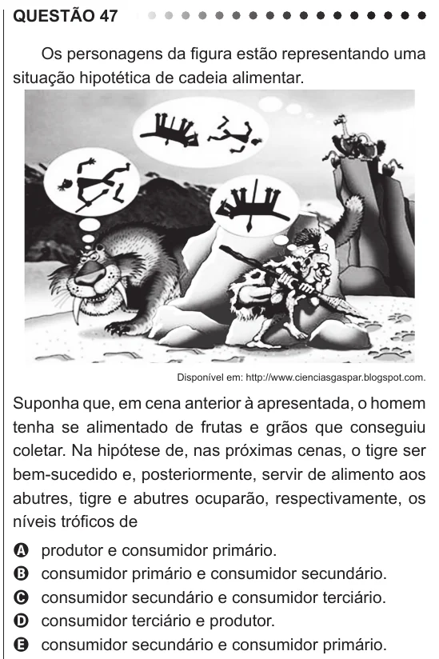

Texto extraído (pode conter ruído)

QUESTÃO 47  
Os personagens da figura estão representando uma  
situação hipotética de cadeia alimentar.  
Disponível em: http://www.cienciasgaspar.blogspot.com.  
Suponha que, em cena anterior à apresentada, o homem  
tenha se alimentado de frutas e grãos que conseguiu  
coletar. Na hipótese de, nas próximas cenas, o tigre ser  
bem-sucedido e, posteriormente, servir de alimento aos  
abutres, tigre e abutres ocuparão, respectivamente, os  
níveis tróficos de  
produtor e consumidor primário.  
A  
consumidor primário e consumidor secundário.  
B  
C  
consumidor secundário e consumidor terciário.  
consumidor terciário e produtor.  
D  
consumidor secundário e consumidor primário.  
E

