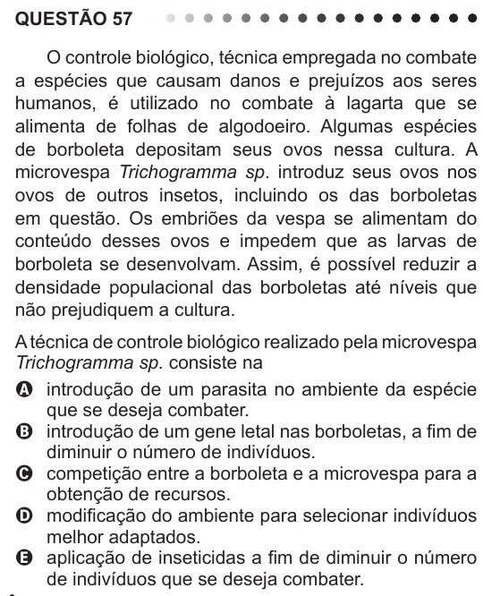

Texto extraído (pode conter ruído)

QUESTÃO 57  
O controle biológico, técnica empregada no combate  
a espécies que causam danos e prejuízos aos seres  
humanos, é utilizado no combate à lagarta que se  
alimenta de folhas de algodoeiro. Algumas espécies  
de borboleta depositam seus ovos nessa cultura. A  
microvespa Trichogramma sp. introduz seus ovos nos  
ovos de outros insetos, incluindo os das borboletas  
em questão. Os embriões da vespa se alimentam do  
conteúdo desses ovos e impedem que as larvas de  
borboleta se desenvolvam. Assim, é possível reduzir a  
densidade populacional das borboletas até níveis que  
não prejudiquem a cultura.  
A técnica de controle biológico realizado pela microvespa  
Trichogramma sp. consiste na  
A introdução de um parasita no ambiente da espécie  
que se deseja combater.  
B introdução de um gene letal nas borboletas, a fim de  
diminuir o número de indivíduos.  
C competição entre a borboleta e a microvespa para a  
obtenção de recursos.  
D modificação do ambiente para selecionar indivíduos  
melhor adaptados.  
E aplicação de inseticidas a fim de diminuir o número  
de indivíduos que se deseja combater.

