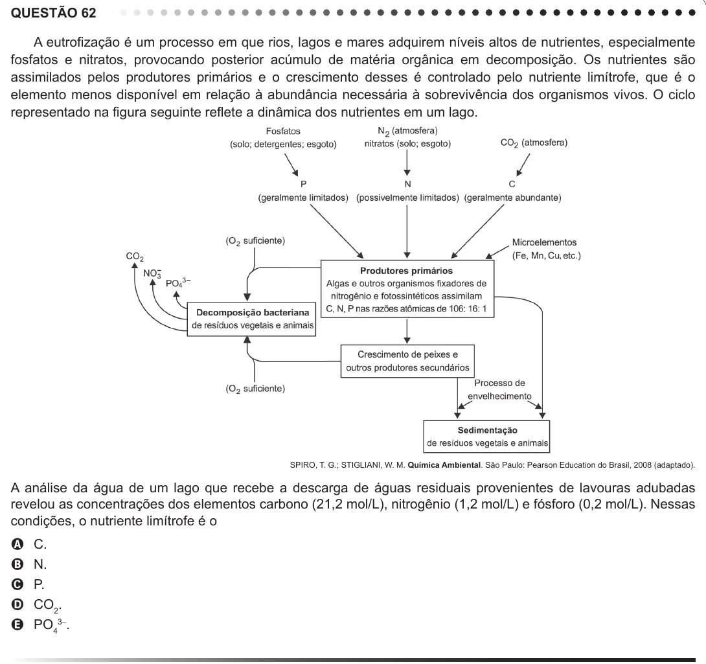

Texto extraído (pode conter ruído)

QUESTÃO 62  
A eutrofização é um processo em que rios, lagos e mares adquirem níveis altos de nutrientes, especialmente  
fosfatos e nitratos, provocando posterior acúmulo de matéria orgânica em decomposição. Os nutrientes são  
assimilados pelos produtores primários e o crescimento desses é controlado pelo nutriente limítrofe, que é o  
elemento menos disponível em relação à abundância necessária à sobrevivência dos organismos vivos. O ciclo  
representado na figura seguinte reflete a dinâmica dos nutrientes em um lago.  
3 -  
4  
SPIRO, T. G.; STIGLIANI, W. M. Química Ambiental. São Paulo: Pearson Education do Brasil, 2008 (adaptado).  
A análise da água de um lago que recebe a descarga de águas residuais provenientes de lavouras adubadas  
revelou as concentrações dos elementos carbono (21,2 mol/L), nitrogênio (1,2 mol/L) e fósforo (0,2 mol/L). Nessas  
condições, o nutriente limítrofe é o  
A  
C.  
B  
N.  
P.  
C  
CO 2 .  
D  
PO 43- .  
E

