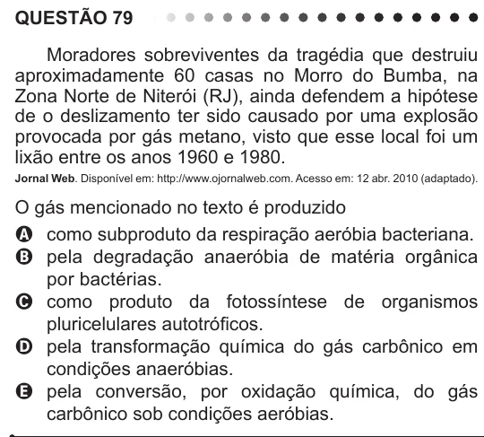

Texto extraído (pode conter ruído)

QUESTÃO 79  
Moradores sobreviventes da tragédia que destruiu  
aproximadamente 60 casas no Morro do Bumba, na  
Zona Norte de Niterói (RJ), ainda defendem a hipótese  
de o deslizamento ter sido causado por uma explosão  
provocada por gás metano, visto que esse local foi um  
lixão entre os anos 1960 e 1980.  
Jornal Web. Disponível em: http://www.ojornalweb.com. Acesso em: 12 abr. 2010 (adaptado).  
O gás mencionado no texto é produzido  
A como subproduto da respiração aeróbia bacteriana.  
B pela degradação anaeróbia de matéria orgânica  
por bactérias.  
C como produto da fotossíntese de organismos  
pluricelulares autotróficos.  
D pela transformação química do gás carbônico em  
condições anaeróbias.  
E pela conversão, por oxidação química, do gás  
carbônico sob condições aeróbias.

