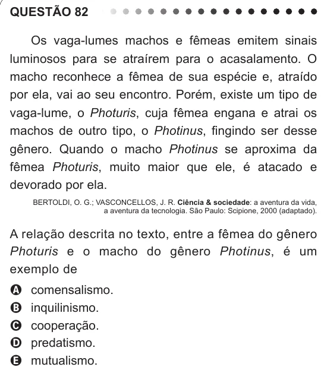

Texto extraído (pode conter ruído)

QUESTÃO 82  
Os vaga-lumes machos e fêmeas emitem sinais  
luminosos para se atraírem para o acasalamento. O  
macho reconhece a fêmea de sua espécie e, atraído  
por ela, vai ao seu encontro. Porém, existe um tipo de  
vaga-lume, o Photuris, cuja fêmea engana e atrai os  
machos de outro tipo, o Photinus, fingindo ser desse  
gênero. Quando o macho Photinus se aproxima da  
fêmea Photuris, muito maior que ele, é atacado e  
devorado por ela.  
BERTOLDI, O. G.; VASCONCELLOS, J. R. Ciência & sociedade: a aventura da vida,  
a aventura da tecnologia. São Paulo: Scipione, 2000 (adaptado).  
a relação descrita no texto, entre a fêmea do gênero  
Photuris e o macho do gênero Photinus, é um  
exemplo de  
comensalismo.  
A  
inquilinismo.  
B  
cooperação.  
C  
D  
predatismo.  
mutualismo.  
E

