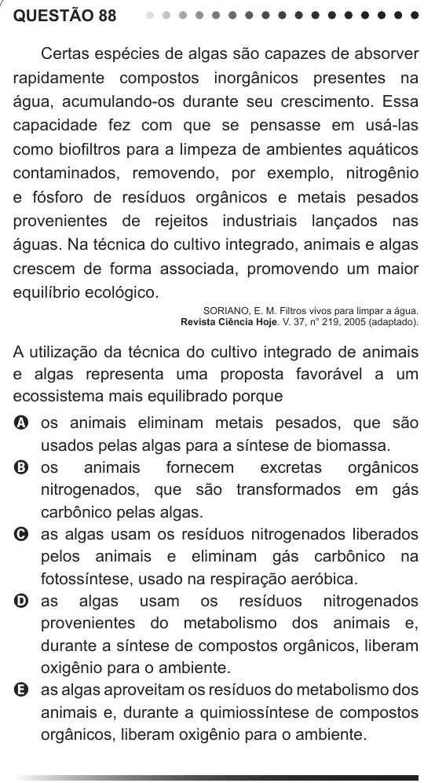

Texto extraído (pode conter ruído)

QUESTÃO 88  
Certas espécies de algas são capazes de absorver  
rapidamente compostos inorgânicos presentes na  
água, acumulando-os durante seu crescimento. Essa  
capacidade fez com que se pensasse em usá-las  
como biofiltros para a limpeza de ambientes aquáticos  
contaminados, removendo, por exemplo, nitrogênio  
e fósforo de resíduos orgânicos e metais pesados  
provenientes de rejeitos industriais lançados nas  
águas. Na técnica do cultivo integrado, animais e algas  
crescem de forma associada, promovendo um maior  
equilíbrio ecológico.  
SORIANO, E. M. Filtros vivos para limpar a água.  
Revista Ciência Hoje. V. 37, n° 219, 2005 (adaptado).  
A utilização da técnica do cultivo integrado de animais  
e algas representa uma proposta favorável a um  
ecossistema mais equilibrado porque  
A os animais eliminam metais pesados, que são  
usados pelas algas para a síntese de biomassa.  
B os  
animais  
fornecem  
excretas  
orgânicos  
nitrogenados, que são transformados em gás  
carbônico pelas algas.  
C as algas usam os resíduos nitrogenados liberados  
pelos animais e eliminam gás carbônico na  
fotossíntese, usado na respiração aeróbica.  
D as algas usam os resíduos nitrogenados  
provenientes do metabolismo dos animais e,  
durante a síntese de compostos orgânicos, liberam  
oxigênio para o ambiente.  
E as algas aproveitam os resíduos do metabolismo dos  
animais e, durante a quimiossíntese de compostos  
orgânicos, liberam oxigênio para o ambiente.

