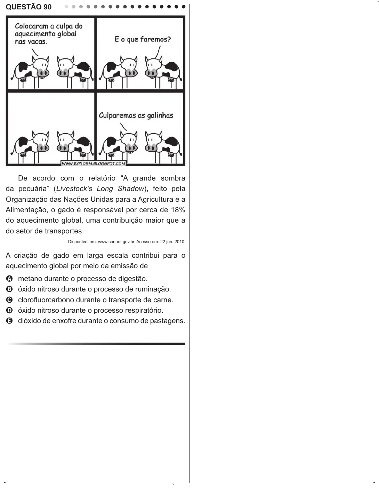

Texto extraído (pode conter ruído)

QUESTÃO 90  
De acordo com o relatório “A grande sombra  
da pecuária” (Livestock’s Long Shadow), feito pela  
Organização das Nações Unidas para a Agricultura e a  
Alimentação, o gado é responsável por cerca de 18%  
do aquecimento global, uma contribuição maior que a  
do setor de transportes.  
Disponível em: www.conpet.gov.br. Acesso em: 22 jun. 2010.  
A criação de gado em larga escala contribui para o  
aquecimento global por meio da emissão de  
metano durante o processo de digestão.  
A  
óxido nitroso durante o processo de ruminação.  
B  
clorofluorcarbono durante o transporte de carne.  
C  
óxido nitroso durante o processo respiratório.  
D  
E  
dióxido de enxofre durante o consumo de pastagens.

