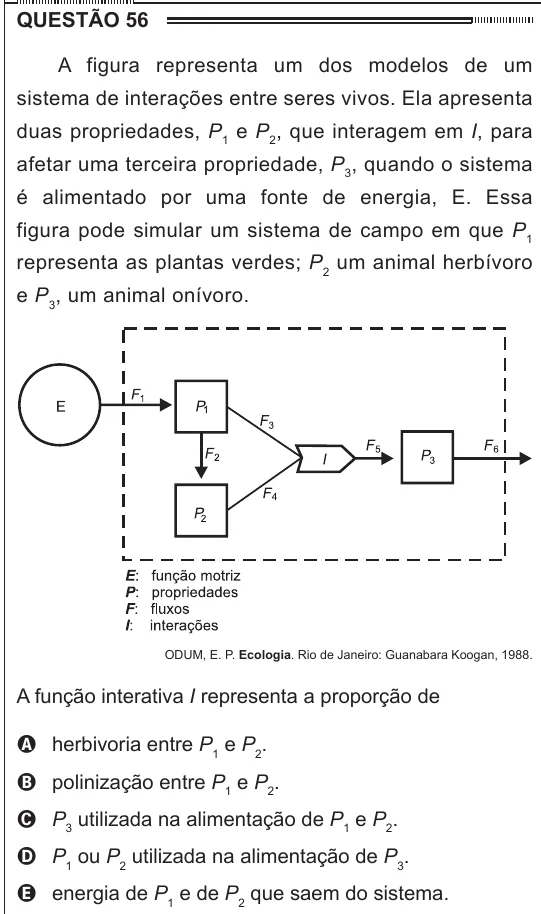

Texto extraído (pode conter ruído)

QUESTÃO 56  
A figura representa um dos modelos de um  
sistema de interações entre seres vivos. Ela apresenta  
duas propriedades, P 1 e P 2 , que interagem em I, para  
afetar uma terceira propriedade, P 3 , quando o sistema  
é alimentado por uma fonte de energia, E. Essa  
figura pode simular um sistema de campo em que P 1  
representa as plantas verdes; P 2 um animal herbívoro  
e P 3 , um animal onívoro.  
ODUM, E. P. Ecologia. Rio de Janeiro: Guanabara Koogan, 1988.  
A função interativa I representa a proporção de  
A herbivoria entre P 1 e P 2 .  
B polinização entre P 1 e P 2 .  
C P 3 utilizada na alimentação de P 1 e P 2 .  
D P 1 ou P 2 utilizada na alimentação de P 3 .  
E energia de P 1 e de P 2 que saem do sistema.

