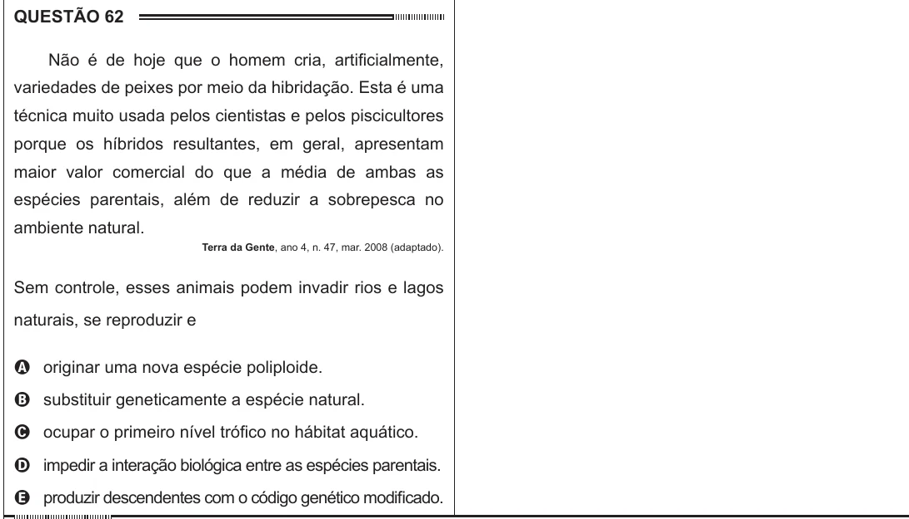

Texto extraído (pode conter ruído)

QUESTÃO 62  
Não é de hoje que o homem cria, artificialmente,  
variedades de peixes por meio da hibridação. Esta é uma  
técnica muito usada pelos cientistas e pelos piscicultores  
porque os híbridos resultantes, em geral, apresentam  
maior valor comercial do que a média de ambas as  
espécies parentais, além de reduzir a sobrepesca no  
ambiente natural.  
Terra da Gente, ano 4, n. 47, mar. 2008 (adaptado).  
Sem controle, esses animais podem invadir rios e lagos  
naturais, se reproduzir e  
A originar uma nova espécie poliploide.  
B substituir geneticamente a espécie natural.  
C ocupar o primeiro nível trófico no hábitat aquático.  
D impedir a interação biológica entre as espécies parentais.  
E produzir descendentes com o código genético modificado.

