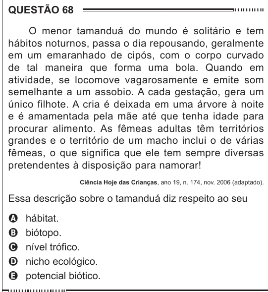

Texto extraído (pode conter ruído)

QUESTÃO 68  
O menor tamanduá do mundo é solitário e tem  
hábitos noturnos, passa o dia repousando, geralmente  
em um emaranhado de cipós, com o corpo curvado  
de tal maneira que forma uma bola. Quando em  
atividade, se locomove vagarosamente e emite som  
semelhante a um assobio. A cada gestação, gera um  
único filhote. A cria é deixada em uma árvore à noite  
e é amamentada pela mãe até que tenha idade para  
procurar alimento. As fêmeas adultas têm territórios  
grandes e o território de um macho inclui o de várias  
fêmeas, o que significa que ele tem sempre diversas  
pretendentes à disposição para namorar!  
Ciência Hoje das Crianças, ano 19, n. 174, nov. 2006 (adaptado).  
Essa descrição sobre o tamanduá diz respeito ao seu  
hábitat.  
A  
biótopo.  
B  
C  
nível trófico.  
nicho ecológico.  
D  
potencial biótico.  
E

