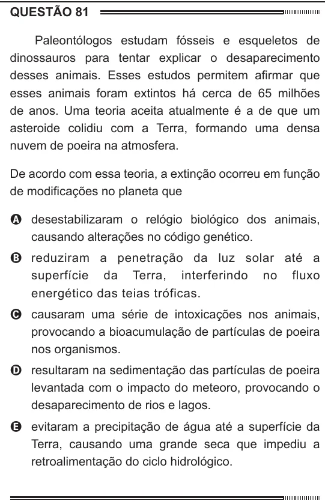

Texto extraído (pode conter ruído)

QUESTÃO 81  
Paleontólogos estudam fósseis e esqueletos de  
dinossauros para tentar explicar o desaparecimento  
desses animais. Esses estudos permitem afirmar que  
esses animais foram extintos há cerca de 65 milhões  
de anos. Uma teoria aceita atualmente é a de que um  
asteroide colidiu com a Terra, formando uma densa  
nuvem de poeira na atmosfera.  
De acordo com essa teoria, a extinção ocorreu em função  
de modificações no planeta que  
A desestabilizaram o relógio biológico dos animais,  
causando alterações no código genético.  
B reduziram a penetração da luz solar até a  
superfície da Terra, interferindo no fluxo  
energético das teias tróficas.  
C causaram uma série de intoxicações nos animais,  
provocando a bioacumulação de partículas de poeira  
nos organismos.  
D resultaram na sedimentação das partículas de poeira  
levantada com o impacto do meteoro, provocando o  
desaparecimento de rios e lagos.  
E evitaram a precipitação de água até a superfície da  
Terra, causando uma grande seca que impediu a  
retroalimentação do ciclo hidrológico.

