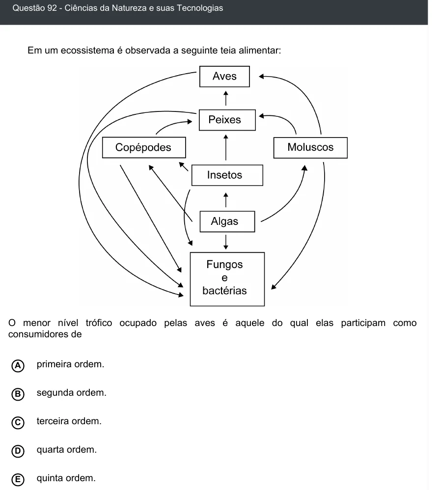

Texto extraído (pode conter ruído)

Questão 92 - Ciências da Natureza e suas Tecnologias  
Em um ecossistema é observada a seguinte teia alimentar:  
O menor nível trófico ocupado pelas aves é aquele do qual elas participam como  
consumidores de  
primeira ordem.  
A  
segunda ordem.  
B  
C  
terceira ordem.  
quarta ordem.  
D  
quinta ordem.  
E

