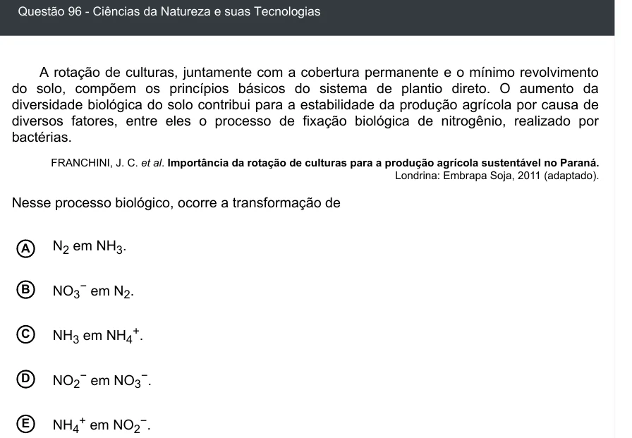

Texto extraído (pode conter ruído)

Questão 96 - Ciências da Natureza e suas Tecnologias  
A rotação de culturas, juntamente com a cobertura permanente e o mínimo revolvimento  
do solo, compõem os princípios básicos do sistema de plantio direto. O aumento da  
diversidade biológica do solo contribui para a estabilidade da produção agrícola por causa de  
diversos fatores, entre eles o processo de fixação biológica de nitrogênio, realizado por  
bactérias.  
FRANCHINI, J. C. et al. Importância da rotação de culturas para a produção agrícola sustentável no Paraná.  
Londrina: Embrapa Soja, 2011 (adaptado).  
Nesse processo biológico, ocorre a transformação de  
N 2 em NH 3 .  
A  
B  
NO 3− em N 2 .  
C  
NH 3 em NH 4+ .  
D  
NO 2− em NO 3− .  
NH 4+ em NO 2− .  
E

